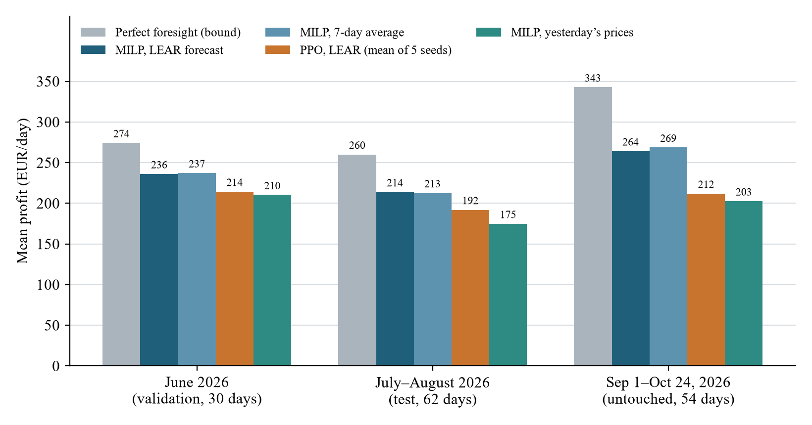
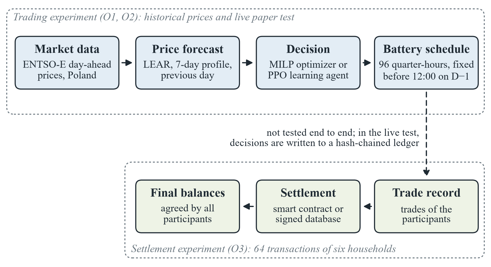
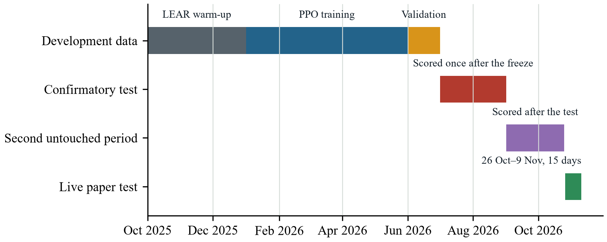
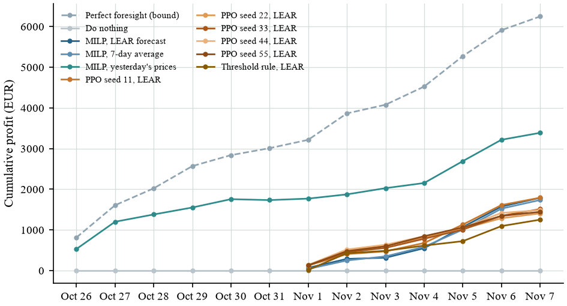

# Optimization of Profit and Risk in Battery Energy Trading on the Polish Day-Ahead Market Using Price Forecasting, Reinforcement Learning and Smart-Contract Settlement

[](https://github.com/tilkitaha/Gridmind/actions/workflows/ci.yml)

GridMind: engineering thesis in Engineering Management at Poznan University of Technology, Faculty of Engineering Management, by Taha Can Tilkioğlu, Cem Yılmaz and Serhat Yiğit, supervised by Dr. Fredrick Mumali.

## The project in brief

A battery earns money on an electricity market by charging when power is cheap and discharging when it is expensive. On the Polish day-ahead market this is harder than it sounds. Prices are set for every quarter-hour, so the battery has to make 96 decisions for each day, and all of them must be fixed before 12:00 on the day before delivery, when the prices of that day are not yet known. The simplest plan assumes that tomorrow will repeat today. In our market data from October 2025 to June 2026, this plan captured only 62.9% of the profit that perfect foresight would have made, and it lost money on 52 of 260 days.

The thesis asks three questions, one per research objective:

1. **Forecast (O1).** Does a battery schedule built on a statistical price forecast (LEAR) earn more, and lose less on its worst days, than a schedule built on yesterday's prices?
2. **Learning agent (O2).** Does a reinforcement-learning agent (PPO) earn more than a mathematical optimizer (MILP) that uses the same forecast?
3. **Settlement (O3).** Does a smart contract settle the energy trades of a local energy community with the same final balances as a signed database, and at what cost?

## Main results

| Objective | Answer | Evidence |
|---|---|---|
| O1: forecast against yesterday's prices | Yes: more profit and smaller losses on the worst days | Confirmatory test, July–August 2026 (62 days): +39.05 EUR/day (95% interval 26.70 to 53.25) and CVaR 5% better by 84.94 EUR/day (15.20 to 136.62); confirmed on the second untouched period, September 1–October 24, 2026 |
| O2: PPO against MILP on the same forecast | No: the optimizer stays ahead | −21.92 EUR/day in the test (−29.84 to −14.20); below the optimizer in the validation month, the test and the second untouched period, with all five seeds |
| O3: smart contract against signed database | Same balances, much higher cost | 64 transactions among six households: identical final balances; median 21.46 ms per transaction for the smart contract and 0.22 ms for the database |

The live paper test, October 26–November 9, 2026, points the same way: on the nine days on which every agent traded, MILP on LEAR earned 352.09 EUR/day, MILP on yesterday's prices 325.97 and the five PPO seeds 267.62 on average. Fifteen days are too few for intervals, so the live test is descriptive.



*Mean daily profit of each policy in the validation month, the confirmatory test and the second untouched period: 1 MW / 2 MWh battery, after wear. Source: own study based on ENTSO-E Transparency Platform data.*

## How the solution works



1. **Prices.** Day-ahead prices of the Polish bidding zone come from the ENTSO-E Transparency Platform, 96 per day.
2. **Forecast.** At the gate, a forecaster turns the prices known so far into 96 prices for the next day: LEAR, a 7-day average, or simply yesterday's prices.
3. **Decision.** The MILP optimizer or the PPO agent turns the forecast into a battery schedule.
4. **Schedule.** The schedule is fixed before 12:00 on the day before delivery and scored at the real prices once they are published. In the live test, every schedule is written to a hash-chained ledger first.
5. **Settlement.** A separate experiment settles energy trades with a smart contract or with a signed database.

The trading experiment covers steps 1–4 and answers O1 and O2; the settlement experiment covers step 5 and answers O3. The two are tested separately: settling the battery's own trades end to end is not part of this study.

The battery is the same everywhere: 1 MW / 2 MWh, 95% charging and discharging efficiency, state of charge between 10% and 90%, and a wear cost of 10 EUR for every MWh charged or discharged. It is a price taker: its orders do not move the price and are accepted in full.

## How it was tested



- **Development, January–June 2026 (180 days).** Every choice of the study was made on these data. PPO was trained on January–May and validated on June.
- **Confirmatory test, July–August 2026 (62 days).** Locked by its hash until the test protocol was frozen on October 26, 2026, then scored once.
- **Second untouched period, September 1–October 24, 2026 (54 days).** Downloaded, locked and scored after the test.
- **Live paper test, October 26–November 9, 2026 (15 delivery days).** Schedules fixed before each real gate on live prices; no order was sent to the market.

Each policy is judged by its mean daily profit in EUR after battery wear and by its CVaR 5%, the mean profit of its worst 5% of days. Every difference between two policies on the same days gets a 95% circular block-bootstrap interval, which respects the dependence between consecutive days.

## Live paper test (complete)



The previous-day optimizer traded from October 26; the agents that need a week of price history joined on November 1. Every schedule was written to the hash-chained ledger before its gate. For three delivery days (October 28 and 30 and November 9, 2026) the ledger reached GitHub only after the gate, so all 102 schedules were recomputed from the price history before their delivery day, which each ledger entry identifies by its hash: every one matched. Standings, daily reports and the timing record: [results/live_paper_trading](results/live_paper_trading/README.md).

## Thesis description (USOS APD)

- **Object of research:** the methods by which an energy-trading enterprise schedules a 1 MW / 2 MWh battery on the day-ahead market, namely a mixed-integer optimizer that plans on a statistical price forecast and a reinforcement-learning agent, and the settlement of energy transactions among independent participants with a smart contract and with a signed database.
- **Subject of research:** the Polish bidding zone of the European day-ahead market, in which an energy-trading enterprise operates the battery, and a local energy community of six households, in which the energy transactions are settled.
- **Objective:** to raise the arbitrage value and reduce the downside risk of the battery compared with scheduling on the previous day's prices, to determine whether a reinforcement-learning agent adds value over an optimizer that uses the same forecast, and to determine whether a smart contract settles the energy transactions with the same final balances as a signed database, and at what processing cost.
- **Engineering problem:** the schedule for all 96 quarter-hours of the next day must be fixed before 12:00 on the previous day, when the prices of that day are not yet known, and the resulting trades must be settled in a way that every participant can check without relying on a single intermediary.
- **Research methods:** a mixed-methods case study in which a document analysis of the market rules is followed by computational experiments on real market data: mixed-integer linear programming of the battery schedule on price forecasts, reinforcement learning with the PPO algorithm, a comparison of daily profit and CVaR 5% with block-bootstrap 95% intervals, a confirmatory test under a protocol frozen in advance, a live paper test and a settlement experiment.
- **Research tools:** day-ahead prices of the Polish bidding zone from the ENTSO-E Transparency Platform; household load and generation profiles from the StoreNet data set; Python with the SciPy (HiGHS) solver and PyTorch; the LEAR price forecast; a smart contract in Solidity on a local Ethereum virtual machine; an SQLite database with Ed25519 signatures; a hash-chained ledger in a public repository.
- **Shortened table of contents:** 1. Introduction; 2. Literature review; 3. Research methodology; 4. Results; 5. Discussion; 6. Conclusions.

**Research question:** to understand the extent to which an enterprise that trades battery-stored electricity on the day-ahead market raises its arbitrage value and reduces its downside risk by scheduling on a statistical price forecast, with an optimizer or a learning agent, rather than on the previous day's prices, and whether a smart contract settles its energy transactions with independent partners with the same final balances as a signed database, and at what processing cost.

**Research objectives:**

- **O1.** To compare the day-ahead arbitrage value and the downside risk of a 1 MW / 2 MWh battery in the Polish market when its schedule is optimized on a statistical price forecast, on previous-day prices and with perfect foresight, and to report the profit, the CVaR 5% and their uncertainty for every policy, over 180 development days and the later test, untouched and live periods.
- **O2.** To compare a reinforcement-learning trading agent with the optimizer that uses the same forecast, and to report the difference in mean daily profit for selected validation, test and untouched periods.
- **O3.** To compare a smart contract with a signed database for settling the energy transactions of a local energy community of six households, and to report the final balances and the processing cost per transaction of each system.

The trading part of the question is answered by the Polish day-ahead study, the settlement part by the settlement experiment. Do not report Irish community savings as Polish arbitrage profit.

## Repository map

| Path | Contents |
|---|---|
| [docs/POLISH_MARKET_STUDY.md](docs/POLISH_MARKET_STUDY.md) | The Polish day-ahead study: method, results, data license |
| [docs/PROTOCOL_POLISH_TEST_DRAFT.md](docs/PROTOCOL_POLISH_TEST_DRAFT.md), `configs/polish_test_protocol.json` | Test protocol, frozen on October 26, 2026 |
| `results/polish_test/`, `results/polish_test_extension/` | Confirmatory test and second untouched period, each with its execution lock |
| [results/live_paper_trading/](results/live_paper_trading/README.md) | Live paper test: ledger, standings, daily reports |
| `results/polish_*` | Development-period experiments: pilot, forecasts, controls, PPO, risk-averse scheduling |
| `src/gridmind_research/` | Research code: `polish_market.py` (battery MILP), `polish_forecast.py` (LEAR and the other forecasts), `polish_rl.py` (PPO), `entsoe.py` (price parser), `ledger_experiment.py` (settlement) |
| `contracts/EnergySettlement.sol` | Smart contract of the settlement experiment |
| `results/extension/` | Settlement records: receipts, signed SQLite database, timings |
| `scripts/`, `research_tests/` | Experiment and verification scripts; 86 research tests |
| [docs/thesis_figures/](docs/thesis_figures/) | Thesis figures (PNG, PDF) with their LaTeX blocks |
| [docs/GRIDMIND_LAB.md](docs/GRIDMIND_LAB.md) | GridMind Lab, the desktop workbench that runs the simulations and the live test |
| `data/` | StoreNet household data and the hashes of the ENTSO-E price files (no prices) |
| `defense/`, other files in `docs/` | Earlier stages of the project (September–October 2026) |

## Trading experiment: Polish day-ahead study

A 1 MW / 2 MWh price-taking battery on the Polish day-ahead market (ENTSO-E 12.1.D, 96 quarter-hours a day). Each schedule is fixed before the 12:00 gate on D−1 and scored at realized prices. In June 2026, the validation month, MILP on the LEAR forecast earns 236.08 EUR/day (86.1% of the 274.32 EUR/day perfect-foresight bound), MILP on a 7-day mean 237.22, MILP on yesterday's prices 210.31, the five PPO checkpoints 206.33–218.64 and a threshold rule 167.75. A forecaster with 24% more error than LEAR earns as much, so forecasters are compared by the profit of their schedules. On October 25, 2026, every experiment was re-run: 4,506 of 4,506 recorded numbers were identical, and the retrained PPO checkpoints match their protocol hashes bit for bit.

The test protocol was frozen on October 26, 2026, and the confirmatory test run once on July–August 2026 (62 days). Hypothesis H1 is supported: schedules on the LEAR forecast earn 39.05 EUR/day more than schedules on yesterday's prices (26.70 to 53.25) and lose less on their worst days (CVaR 5% +84.94 EUR/day, 15.20 to 136.62). PPO earns 21.92 EUR/day less than MILP on the same forecast (−29.84 to −14.20). A second untouched period, September 1–October 24, 2026, confirms both directions; its CVaR interval alone includes zero, and H1 pooled over both periods is supported. Details: [test results](docs/POLISH_MARKET_STUDY.md#confirmatory-test-and-second-untouched-period-26-october-2026).

- [Study, results and data license](docs/POLISH_MARKET_STUDY.md) and [test protocol](docs/PROTOCOL_POLISH_TEST_DRAFT.md), frozen on October 26, 2026; results in `results/polish_test/` and `results/polish_test_extension/`.
- [Live paper test](results/live_paper_trading/README.md): 15 delivery days, October 26–November 9, 2026, hash-chained ledger, standings and public daily reports.
- [GridMind Lab](docs/GRIDMIND_LAB.md): the desktop workbench that runs the simulations, the live test, the finance view, the experiment re-runs and the figures, with screenshots.
- [Thesis figures](docs/thesis_figures/) with their LaTeX blocks.
- [Risk-averse scheduling](docs/RISK_AVERSE_SCHEDULING.md) (exploratory, added after the test): a mean-CVaR MILP on LEAR error scenarios. With the weight picked on development data (0.25), mean profit and CVaR 5% do not differ detectably from the risk-neutral MILP in any period; results in `results/polish_cvar/`.

ENTSO-E prices are not redistributed: only their SHA-256 hashes are committed (`data/polish/*/provenance.json`), and `scripts/verify_polish_data.py` checks a fresh download against them.

## Settlement experiment

The same 64 energy transactions among six StoreNet households (H1–H6) are settled by a Solidity smart contract (`contracts/EnergySettlement.sol`) on a single-process local Ethereum virtual machine and by an SQLite database with Ed25519 signatures. Both reach identical final balances; the median processing time per transaction is 21.46 ms for the smart contract and 0.22 ms for the database, and the contract uses a median of 68,917 gas per transaction. No distributed network is involved and no real money is moved. Records: `results/extension/`; check them with `scripts/verify_saved_ledger.py`.

## Earlier stages of the project (September–October 2026)

Before the thesis was focused on the Polish day-ahead market, the project studied a six-household StoreNet community with multi-agent reinforcement learning and model-predictive control. These results are exploratory and are not part of the thesis results; they are kept for reproducibility.

### Earlier thesis draft and defense package (September 2026)

- [Complete PDF package: 124 pages](defense/GridMind_Complete_PDF_Package.pdf)
- [80-page thesis](defense/GridMind_Thesis_Development.pdf)
- [Scientific release addendum](defense/GridMind_Scientific_Addendum.pdf)
- [Defense slides PDF](defense/GridMind_Defense.pdf) and [editable PowerPoint](defense/GridMind_Defense.pptx)
- [Defense guide](defense/GridMind_Defense_Guide.pdf)
- [Scientific release and decision gates](docs/SCIENTIFIC_RELEASE.md)

Release packaging and descriptive synthesis updated September 30, 2026. The complete PDF includes the addendum, manuscript, slides and guide, with bookmarks. No new independent test was performed.

### Completed evidence

- Ten original IPPO/MAPPO policies and sixty additional training runs, with checkpoint replay and household outcomes.
- A 2-by-2 action/budget study: discrete versus bounded continuous actions at 60 versus 300 updates, two algorithms and five seeds.
- A matched fairness-reward study: two fourteen-input reward arms, two algorithms and five seeds. One fixed penalty weight; no consistent improvement.
- Actual forecast-to-MPC coupling: persistence, previous-day, recursive household Ridge and a non-causal oracle on the same 44 episodes.
- Local Solidity execution and Ed25519-signed SQLite agreement over the same 64 transactions.
- A tested aggregate Polish BESS MILP and strict clock/forecast input validation, with analytical fixtures only.

The 300-update discrete learners all reproduce idle cost, 159.4083 EUR. Persistence MPC costs 159.1604 EUR and Ridge MPC 158.8618 EUR. Ridge MPC leaves two households worse off than idle. All June results are exploratory on reused dates, not confirmation on an untouched test.

### Later temporal evaluation

The frozen-model extension adds 501 episodes from July–December 2020, across 168 retained days (45.38% of candidate blocks). All sixty follow-up policies are evaluated without retraining against five baseline controllers. Idle costs 1947.4997 EUR, persistence MPC 1946.6754 and Ridge MPC 1939.3432. Ridge saves 7.3322 EUR against persistence; all six households gain against idle in aggregate over the retained later period. The primary discrete-IPPO versus persistence seven-day interval includes zero. Strong missingness at midnight and 04:00 limits interpretation. Prior partial access is disclosed, so this remains exploratory.

See [temporal reproduction](docs/LATER_PERIOD_REPRODUCTION.md), `results/later_period/` and the read-only `scripts/verify_later_period.py` audit.

### Episode length (exploratory, October 2026)

Every retained episode lasts four hours and ends at 1 kWh, so the 0.20 EUR night tariff and the 0.42 EUR evening peak never share an episode. On the 501 later-period episodes a perfect-foresight controller saves only 60.20 EUR (3.09% of idle); Ridge MPC captures 13.6% of that bound and the discrete learners 0%. On 164 days with at least 80 of 96 observed slots, 24-hour episodes raise the bound from 95.15 to 283.51 EUR, and causal Ridge MPC saves 113.55 EUR (3.47% of idle) with no household worse off. Persistence MPC loses money at both lengths, and the retained IPPO/MAPPO learners trained on 24-hour episodes do not save money (8 of 20 stay idle, the rest lose 73–173 EUR); with GAE λ = 1.0, chosen post hoc, 5 of 10 continuous learners save 66–101 EUR. No 2020 day has all 96 slots; two gap fills agree within 0.6 EUR. These dates were inspected before, so the result is exploratory.

See [episode-length exploration](docs/EPISODE_LENGTH_EXPLORATION.md), `scripts/explore_episode_length.py`, `scripts/explore_mpc_24h.py`, `scripts/explore_rl_24h.py` and `results/exploratory_*`.

### Held-out household study (draft)

The StoreNet collection has twenty households; this repository uses only H1–H6. A [draft protocol](docs/PROTOCOL_24H_HOLDOUT_DRAFT.md) tests 24-hour Ridge MPC once on H7–H20. Its pipeline (`src/gridmind_research/holdout.py`, `scripts/holdout_*.py`) refuses to download or evaluate held-out households until the protocol is frozen, and locks protocol, data and code hashes between stages. A dry run on H1–H6 (`results/holdout_24h_dry_run/`) reproduces the exploratory numbers exactly. No held-out meter data have been read.

### Profit-oriented forecast selection (October 2026)

An exploratory selector chooses among LEAR and simple forecasts using only their past
28-calendar-day MILP profit. On 166 common development days it averages 183.91 EUR/day,
versus 181.83 for always-LEAR and 183.08 for the seven-day mean profile. These are reused
development outcomes, not independent evidence of improvement. No new forecast is trained.
See [method, limits and reproduction](docs/PROFIT_ORIENTED_FORECASTING.md).

A [matched profit-versus-error comparison](docs/FORECAST_SELECTION_COMPARISON.md)
holds four candidate forecasts and their history fixed. Profit selection earns
179.66 EUR/day versus 181.70 for error selection; the exploratory difference interval
includes zero. This uses a different candidate panel from the five-model experiment above.

## Reproduction

Python 3.12 and the pinned research dependencies are used. Included StoreNet data and saved results require no API key.

```bash
python -m venv .venv
source .venv/bin/activate
python -m pip install -r requirements-extension.txt
export PYTHONPATH=src
python -m unittest discover -s research_tests -v
python scripts/verify_defense_evidence.py
python scripts/verify_follow_up.py
python scripts/verify_saved_ledger.py
python scripts/verify_later_period.py
```

Windows PowerShell uses `.venv\Scripts\Activate.ps1` and `$env:PYTHONPATH = "src"`.

The Polish study needs the ENTSO-E prices, which cannot be redistributed: with your own ENTSO-E token, `scripts/fetch_entsoe_prices.py` downloads them and `scripts/verify_polish_data.py` checks every file against the committed hashes.

CI runs `ruff check .`, `pytest -q` and the research tests on every push, with CPU-only PyTorch.

See [original reproduction](docs/EXTENSION_REPRODUCTION.md), [follow-up reproduction](docs/ABLATION_REPRODUCTION.md), [Polish study](docs/POLISH_MARKET_STUDY.md), and [defense materials](defense/START_HERE.md). Training and forecast reruns replace their own result directories; preserve an unchanged archive first. Verification scripts only read retained records.

## Evidence boundary

- The Polish results are paper trading by a price taker: the battery's orders do not move the price and are accepted in full. Intraday and balancing markets, grid fees, taxes, exchange fees and the cost of building the battery are not included.
- The confirmatory test and the second untouched period carry the evidence with intervals. The live paper test covers 15 delivery days (nine for the forecast-based agents) and is descriptive.
- The settlement experiment runs on a single-process local Ethereum virtual machine; it measures no distributed network and moves no real money.
- The household data contain measured consumption and PV, not observed retail bills or market trades. The Irish community results of the earlier stages are exploratory and are not part of the thesis results.
- The 86 research tests establish specific invariants; they do not validate profitability or deployment.

## Sources and license

ENTSO-E Transparency Platform, day-ahead prices (12.1.D), bidding zone PL. The prices may be used but not redistributed, so the repository keeps only their SHA-256 hashes and the scripts that download them.

Trivedi, Bahloul, Saif, Patra and Khadem (2024), Comprehensive Dataset on Electrical Load Profiles for Energy Community in Ireland, Scientific Data 11, 621. [Paper](https://doi.org/10.1038/s41597-024-03454-2). [Collection](https://doi.org/10.6084/m9.figshare.c.6829134). The retained source metadata specify CC0; the bundled CSV is a derived subset. `scripts/rebuild_data.py` checks original hashes if public downloads are accessible. The September 28, 2026 download succeeded and all six original file hashes matched. Both the original subset and full-year processed input are included; raw file identifiers and CC0 provenance remain in the manifest.

`src/app` is a legacy API scaffold and is not the research controller. Product plans in `docs/archive` are historical. Software retains its MIT license; source data have their own license.
