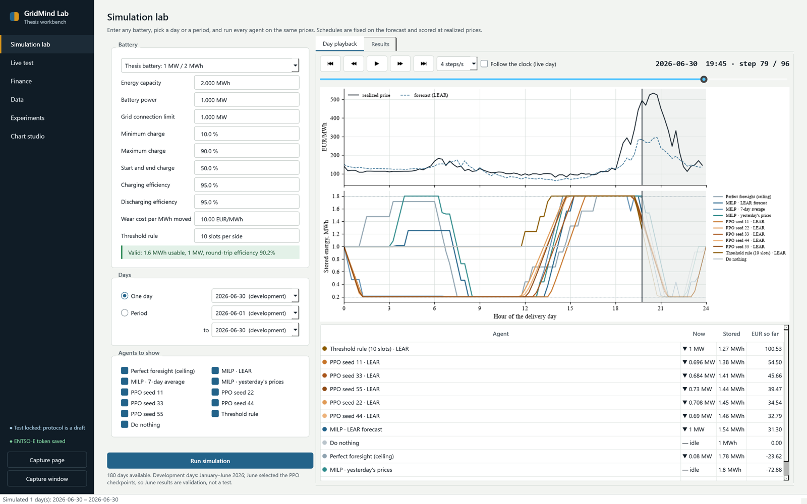
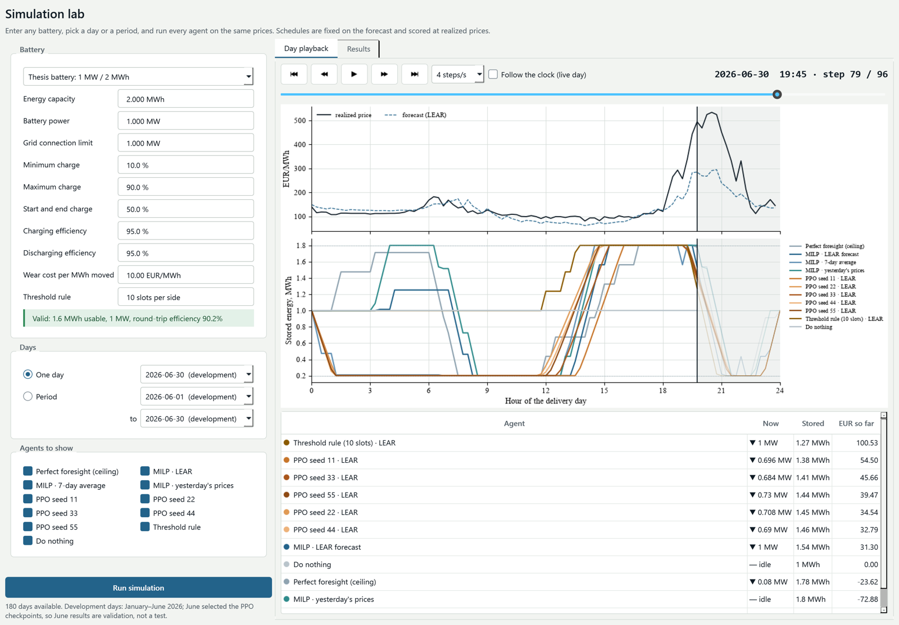
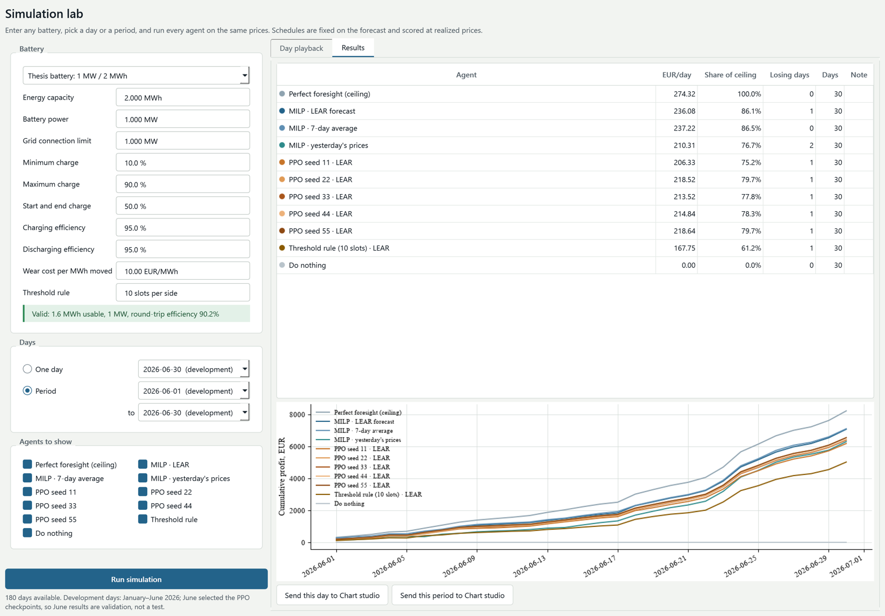
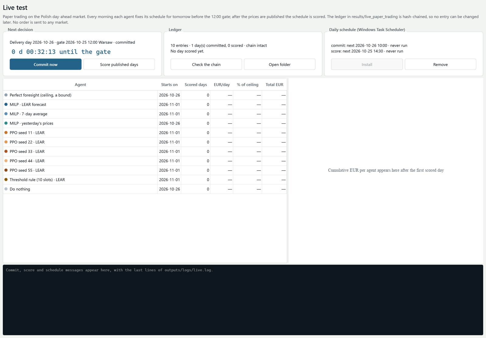
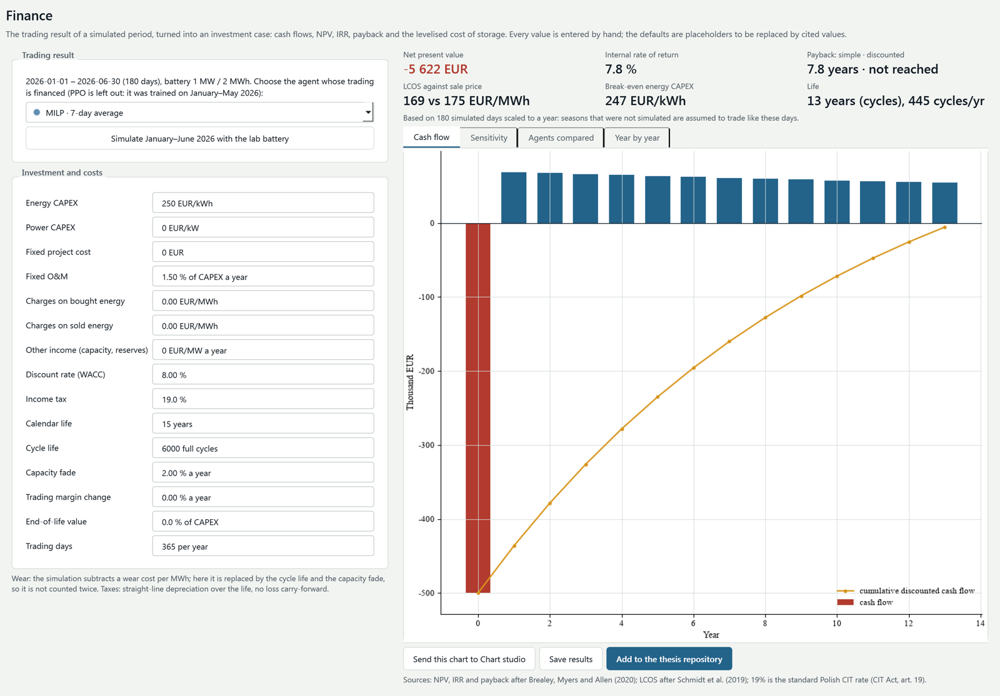
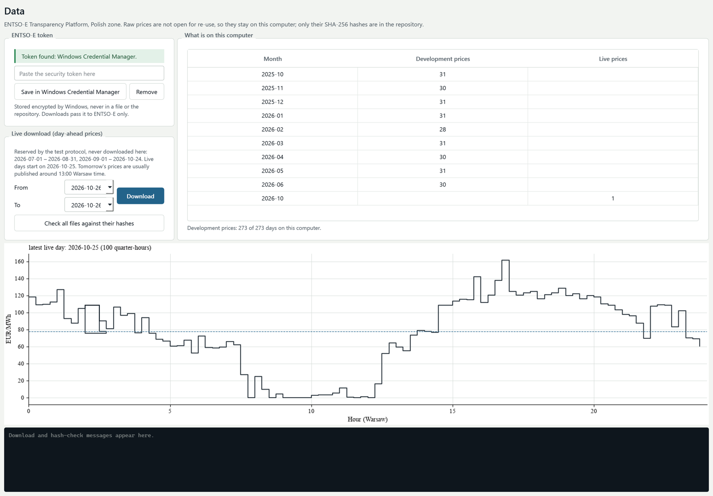
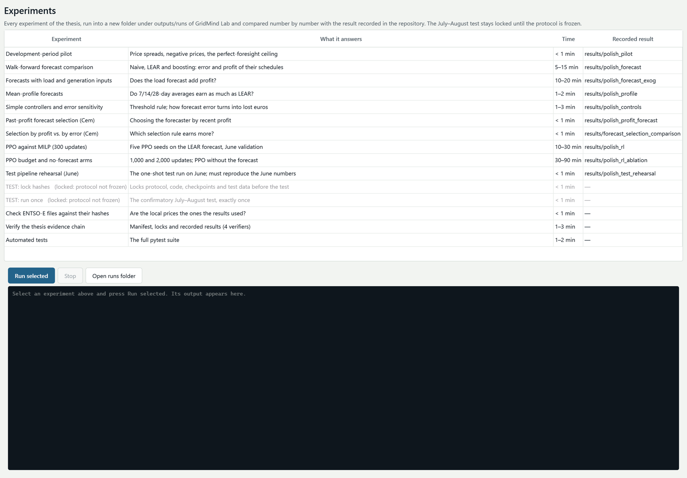
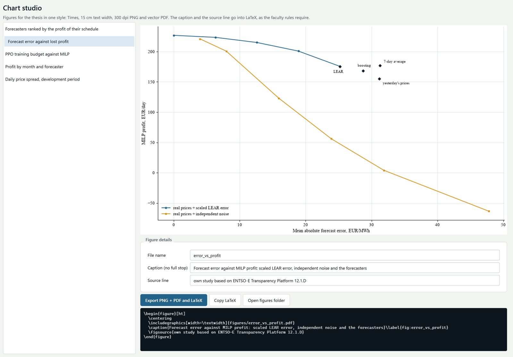

# GridMind Lab: the thesis workbench

GridMind Lab is the desktop application the team uses to run the Polish day-ahead study: it simulates every agent on any battery, runs the live paper test, turns trading results into an investment case, re-runs every thesis experiment, and exports the thesis figures. It runs on one computer (Windows, PySide6) and reads this repository; its own code is kept outside the repository. Only results come back here: the live ledger in `results/live_paper_trading/`, the price-file hashes in `data/polish/live/provenance.json`, and the figures in `docs/thesis_figures/`.

## How the agents work

At the day-ahead gate (12:00 Warsaw time on D−1) the prices up to and including D−1 are known. A forecaster turns them into 96 quarter-hour prices for D; an agent turns a forecast into a 96-step power schedule. The schedule is fixed before the prices of D exist and is scored against them afterwards. The simulation and the live test call the same agent code, so a live result and a backtest result mean the same thing. On three June days the live pipeline, with LEAR recomputed from scratch, reproduced the simulation to within 6 × 10⁻⁷ EUR.

| Agent | Forecast | Decision | First live delivery day |
| --- | --- | --- | --- |
| MILP, yesterday's prices | prices of D−1 | mixed-integer schedule (`polish_market.optimize_schedule`) | 26 October 2026 |
| MILP, 7-day average | mean of the 7 days before D | same MILP | 1 November 2026 |
| MILP, LEAR | `polish_forecast.lear`, refitted every day on all earlier days | same MILP | 1 November 2026 |
| PPO, seeds 11–55 | LEAR | the five protocol checkpoints (`forecast_2000`, SHA-256 checked) | 1 November 2026 |
| Threshold rule | LEAR | full power in the 10 cheapest and 10 dearest quarter-hours | 1 November 2026 |
| Do nothing | – | zero schedule | 26 October 2026 |
| Perfect foresight | realized prices | MILP on the prices themselves; a bound, not an agent | – |

The test starts from fresh prices, so an agent joins only when the history it needs exists: LEAR needs the prices of D−1, D−2, D−3 and D−7. PPO was trained for the 1 MW / 2 MWh thesis battery and is offered only for it; MILP, the rule and the bound work for any battery entered on the Simulation lab page.

## Pages

### Simulation lab

Every battery parameter is entered by hand (capacity, power, grid limit, charge limits, efficiencies, wear cost) and validated before use. One day plays back quarter-hour by quarter-hour; a period gives each agent's mean profit, share of the bound and losing days. June 2026 is the validation month: PPO was trained on January–May, so its profit on those months is in-sample.

### Live test

The countdown to the next gate, the state of the hash-chained ledger, the daily Windows Task Scheduler entries and the standings. Two tasks run every day and two minutes after every sign-in: commit at 10:00 Warsaw time (download missing prices, fix the next open day's schedules) and score at 14:30 (download published days, score open schedules, write the daily reports). A commit after the gate, or a second commit for the same day, is refused, so extra runs are harmless.

### Finance

A simulated period becomes an investment case: cash flows, net present value, internal rate of return, simple and discounted payback, levelized cost of storage against the sale price, break-even energy CAPEX and an NPV sensitivity chart. The simulated wear cost is replaced by an explicit life (calendar years or cycle life, whichever ends first) and capacity fade, so wear is not counted twice. All inputs are entered by hand; the defaults are placeholders that must be replaced by cited values. Formulas: NPV and IRR after Brealey, Myers and Allen (2020); LCOS after Schmidt et al. (2019); 19% is the standard Polish corporate income tax rate.

### Data

The ENTSO-E token is stored in the Windows Credential Manager, never in a file. The page shows which months are on the computer, downloads live days (never the reserved windows), downloads the development prices on a new computer and compares every file with its recorded SHA-256.

### Experiments

Every thesis experiment, run into a new folder and compared number by number with the result recorded in `results/`. The July–August confirmatory test stays locked until `configs/polish_test_protocol.json` is frozen.

### Chart studio

Thesis figures in one style (Times New Roman, 15 cm text width, 300 dpi PNG and vector PDF) with the LaTeX block: caption below the figure, then `\figsource`, as the faculty rules require.

## The live paper test

The test began with delivery day 26 October 2026 and is planned for 15 delivery days (26 October–9 November 2026). To start it, the end of the protocol's fallback window was moved from 31 October to 24 October 2026 (`configs/polish_test_protocol.json`, `window_change`): prices from 25 October on are read by the live test, and 1 September–24 October 2026 stays unread. No order is ever sent to a market; this is paper trading.

Each ledger line in `results/live_paper_trading/ledger.jsonl` is one of:

- `commit`: an agent's 96 power values for a day, written before the gate, with the SHA-256 of the price history and of the forecast it used
- `skip`: an agent that could not decide yet, with the reason
- `score`: the realized EUR of a commitment, with the SHA-256 of the price file
- `bound`: the perfect-foresight profit of that day

Every entry stores the SHA-256 of the entry before it (`prev`) and its own (`hash`, over the entry without this field), so changing, removing or reordering any earlier entry breaks every later hash. Pushing the ledger before noon adds an outside timestamp: the GitHub commit.

The standings, a cumulative-profit chart and the public daily reports are in [results/live_paper_trading](../results/live_paper_trading/README.md), updated after every scored day.

## Daily reports

After every scored day, two PDF reports are written. The full report, with every quarter-hour price of the day, stays on the team computer. The public report, in `results/live_paper_trading/reports/`, has the same results, status and cumulative profit, but no ENTSO-E prices. Both follow the thesis writing rules (numbered headings, table captions above, figure captions below, a source line under each) and American English.

## Re-run of every experiment (25 October 2026)

Every unlocked experiment was re-run from the code in this repository and compared with its recorded result:

| Experiment | Numbers compared | Identical |
| --- | ---: | ---: |
| Development-period pilot | 23 | 23 |
| Mean-profile forecasts | 85 | 85 |
| Simple controllers and error sensitivity | 120 | 120 |
| Past-profit forecast selection | 31 | 31 |
| Selection by profit vs. by error | 99 | 99 |
| Test pipeline rehearsal (June) | 96 | 96 |
| Walk-forward forecast comparison | 92 | 92 |
| Forecasts with load and generation inputs | 156 | 156 |
| PPO against MILP (300 updates) | 387 | 387 |
| PPO budget and no-forecast arms | 3,417 | 3,417 |
| **Total** | **4,506** | **4,506** |

The five PPO checkpoints retrained from scratch have the same SHA-256 as those registered in the protocol, with bit-identical weights. On a 16 GB computer the PPO ablation was run with at most four trainings at once instead of fifteen; every job seeds itself, and the identical result confirms that the number of workers does not matter. The four evidence verifiers, the data hash check and the test suite passed.

## Thesis figures

`docs/thesis_figures/` holds the figures (PNG, and PDF where the figure carries no raw price series), one LaTeX block per figure and `all_figures.tex`; `reproduction_table.tex` is the table above. Learning agents appear for June 2026 only. The 30 June 2026 figure is kept as PNG only, because its vector PDF would carry that day's prices exactly; the PDF can be exported locally in Chart studio.

## Data and license

ENTSO-E day-ahead prices (12.1.D) are not on ENTSO-E's list of data for free re-use, so they are never committed: not as files, not in tables, not in the public reports. The repository keeps their SHA-256 hashes, and anyone with an ENTSO-E token can download the same days and check them with `scripts/verify_polish_data.py`. Figures that show price curves appear in the thesis with their source line.

## Limits

- Paper trading assumes a price taker: the battery's own bids do not move the price, and every order is accepted in full.
- Fifteen days are a short sample; in the first six days only the yesterday's-prices agent trades.
- The live test is exploratory. The confirmatory test is the July–August 2026 window, still locked.
- Finance results depend on placeholder inputs until each input has a cited source.
