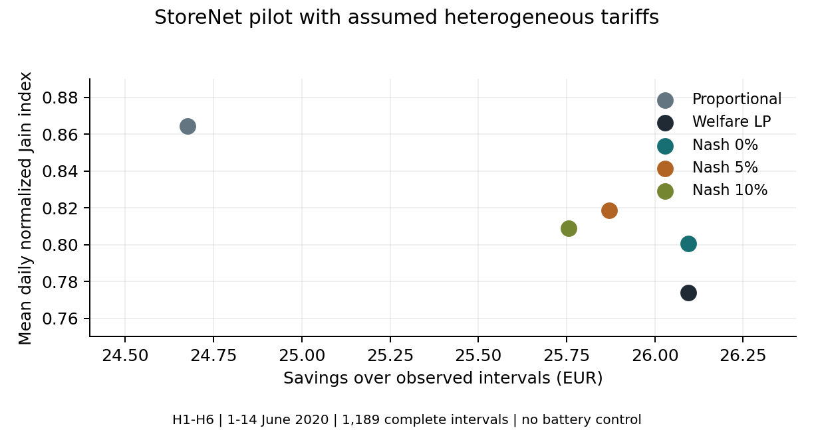
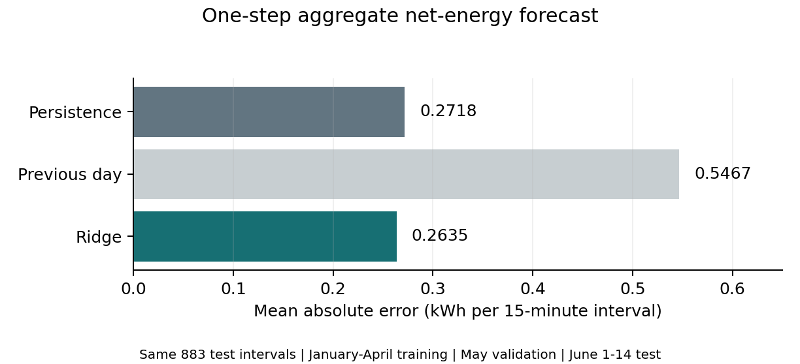
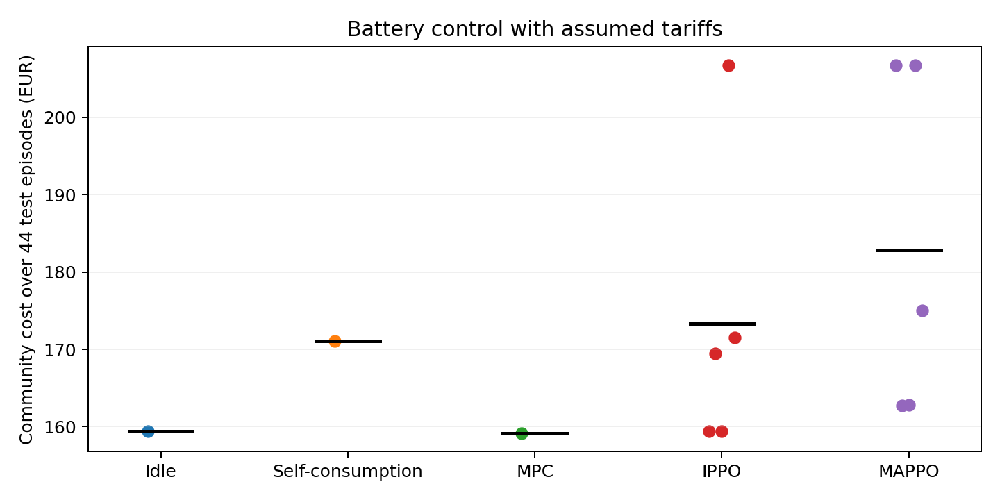

> HISTORICAL WORKING TEXT. The current manuscript is defense/GridMind_Thesis_Development.docx and its PDF. Sections 4.7 and 6.12–6.14 now report the July–December frozen-model evaluation; see docs/LATER_PERIOD_REPRODUCTION.md. This note predates the 60-run study, forecast-to-MPC experiment and Polish scheduling components. It is not the current evidence statement.

# AI and Blockchain Integration in Smart Grids for Autonomous Energy Trading and Risk Optimization

Taha Can Tilkioğlu  |  Engineering Management
Poznań University of Technology  |  16 September 2026

### Abstract

This study develops an evaluation framework for energy sharing among households that consume and produce electricity. The community is the primary beneficiary, and a coordinating service allocates economic gains while respecting explicit energy and accounting constraints. The research question is whether a learning-based controller can improve the distribution of bill savings without giving up an unacceptable share of a strong optimizer’s economic performance. Forecast uncertainty, battery flexibility and settlement infrastructure are treated as distinct experimental factors.

A reproducible pilot uses consumption and photovoltaic measurements from six StoreNet households in Ireland. The experiment compares proportional allocation, welfare-maximizing linear programming and a regularized Nash allocation with a configurable welfare floor. It also evaluates a separate causal one-step Ridge forecasting model. The pilot reveals that tariff homogeneity can make total savings invariant to the allocation rule when matched volume is unchanged, while different fairness metrics can rank the same policies differently. These findings define a more precise experimental problem and show why a simple proportional comparator must be retained.

The completed extension adds battery control, trained IPPO/MAPPO policies and a local EVM contract. MPC slightly reduces cost; learned policies do not beat it under the fixed budget. Contract and signed-database balances match over 64 settlements. Sections 18–23 report these experiments and their limits.

### Reading guide

Sections 1–9 develop the research design. Sections 10–12 report the completed pilot and its limitations. Sections 13–15 cover verification, the completion plan and a Turkish working summary. Sections 18–23 report the completed battery, learning and ledger experiments.

## 1 Research question and scope

The earlier community report and detailed roadmap identify the fairness–welfare relationship as the principal contribution. GridMind should therefore evaluate a community of prosumers, coordinated by an energy-management service, rather than simultaneously optimize a marketplace operator’s revenue, a wholesale trader’s profit and household welfare. The coordinator implements the community’s declared objective; it is not assumed to own every household’s assets or to be an independently licensed supplier.

### Primary question

Can a learning-based community controller improve the distribution of household bill savings while retaining at least 95 percent of the savings achieved by a strong optimization baseline, under the same information, tariffs and physical constraints? The 95 percent level is a proposed research tolerance for the final protocol. It is not an established legal rule, a supervisor-approved threshold or a guaranteed result.

### Testable hypotheses

| Hypothesis | Comparison and decision rule |
| --- | --- |
| H1 Distribution | Compared with the economic optimizer, the proposed controller increases mean daily normalized Jain, with a paired uncertainty interval reported. |
| H2 Economic retention | The lower uncertainty bound on retained savings meets the predeclared 95 percent tolerance. Use absolute differences when baseline savings approach zero. |
| H3 Forecast value | Under a fixed controller, better forecasts improve realized cost or risk. Forecast error reduction alone does not establish trading value. |
| H4 Ledger value | A permissioned ledger offers a measured benefit over a signed database under a specified trust/failure model; otherwise retain the simpler system. |

The primary geographical case is proposed as Ireland, matching the community report and StoreNet measurements. European market design provides the wider setting. Country-specific metering, supplier arrangements and charges must be established before any claim about deployable settlement. The six-house pilot is a methodological demonstration within this scope.

Core work comprises a validated simulator, fair and economic baselines, a causal forecast/control comparison, household-level outcomes and reproducibility. Battery control supplies a meaningful intertemporal decision problem for learned agents. A full blockchain network and feeder power-flow validation are bounded extensions, consistent with the previous roadmap; their absence must remain visible in the final claims.

## 2 Revisions that strengthen the thesis

Several assumptions in the earlier material need correction before they become thesis claims. The revisions below preserve the selected community topic while making the study falsifiable and the comparisons fair.

| Earlier formulation | Revised formulation |
| --- | --- |
| Community structure makes blockchain necessary | Define who writes, who is trusted and what failure must be resisted. Compare a signed database with a ledger; community membership alone does not prove necessity. |
| Nash utility can be applied to any profit | Define savings relative to a grid-only outside option. Specify positivity, normalization and regularization before taking logarithms. |
| Jain and Gini establish fairness by themselves | Declare whose benefits, over which time horizon, and with which normalization. Report losers, zero-gain participants and raw monetary outcomes. |
| All energy trading uses marginal uniform pricing | Distinguish the day-ahead auction, intraday trading and local energy-sharing settlement. This pilot uses an explicitly specified bilateral midpoint. |
| A 15-minute model is always required | Match the decision to its market and data. Finer resampling does not invent information; 30-minute measurements cannot become independent 15-minute observations. |
| Rule-based versus proposed AI is sufficient | Include proportional sharing, an economic LP/MPC baseline and a fairness optimizer, then compare learned policies under equal information. |
| Recent headline percentages are targets to beat | Do not transfer improvement percentages across different datasets, vehicles, tariffs or baselines. Verify each source and compare methods on the same test set. |

The original Python package contained a threshold-based dispatch suggestion and a constant mean forecast. Those functions remain a compatibility scaffold. The new research layer supplies actual optimization, a fitted forecasting model, provenance records and testable accounting. The existing website and the empty GitHub repository are separate from this delivered code package.

The pilot also motivates an additional correction: when every household has the same outside tariffs and total matched energy is fixed, changing allocation changes distribution but cannot change total community savings. A study that ignores this identity risks interpreting a numerical artifact as an economic contribution.

## 3 Research foundations and contribution

The literature supports separate foundations for forecasting, control, fairness and trust. Their integration should be evaluated through controlled comparisons; combining familiar methods is not, by itself, evidence of a new scientific result.

### Forecasting and control

Lago et al. provide an open electricity-price forecasting benchmark and emphasize defensible comparative evaluation [1]. GridMind adopts the methodological principle of strong simple baselines, chronological evaluation and reported error metrics. Its current pilot forecasts aggregate net energy one step ahead, so it must not inherit performance claims from a day-ahead price benchmark. CityLearn offers a reference environment for comparing rule-based, model-predictive and reinforcement-learning energy control [2]. Its use does not automatically validate an Irish market model.

### Learning across multiple households

Yu et al. demonstrate the effectiveness of PPO-based methods in cooperative multi-agent testbeds [3]. This supports using MAPPO as a candidate comparison, but it is not evidence that MAPPO will outperform optimization in this energy community. A fair test requires the same observations, feasible actions, horizon and training budget. The independent-agent and cooperative-agent variants should differ in the intended coordination mechanism, not in privileged access to future data.

### Fairness and risk

Jain, Chiu and Hawe provide a bounded resource-allocation index [4]. In GridMind, applying it to normalized bill savings is a modelling decision that must be defended separately. Rockafellar and Uryasev provide an optimization representation of conditional value at risk [5]. GridMind uses this representation to specify a future daily-cost risk constraint and implements the empirical fractional-tail calculation for diagnostics.

### Data and trust

StoreNet provides a relevant Irish community measurement source [6,7]. The larger CER archive is an alternative subject to its access conditions and temporal resolution [8]. Wüst and Gervais provide a decision framework for assessing whether a blockchain is appropriate [9]. Their framework motivates a trust-model comparison, rather than a blanket assertion that a community needs a blockchain.

### Proposed contribution

The defensible contribution is a reproducible examination of how forecasting, control and a stated fairness rule affect the allocation of household savings under energy constraints. The thesis can contribute a negative result: for example, that proportional allocation remains competitive, that forecast gains do not translate into control value, or that the ledger adds overhead without useful fault resistance. A claim of novelty should be limited to the exact evaluated design and supported by a completed literature comparison.

## 4 Market setting and data strategy

European day-ahead market coupling has transitioned to 15-minute market time units, with the first delivery day on 1 October 2025 [10]. This informs a contemporary wholesale extension. It does not mean that a local study using older household measurements represents the same market regime, or that all European settlement rules are identical.

The European Commission describes updated energy-sharing rights applying from 17 July 2026 and the role of national implementation [11]. GridMind should distinguish local sharing among members from the community’s external supplier or balance-responsible arrangement. A smart contract does not itself create the right to supply electricity, alter metering responsibilities or remove network charges. These are research-boundary statements; operational compliance is outside the pilot.

| Data source | Use and boundary |
| --- | --- |
| StoreNet Ireland | Primary measured load/PV case. The delivered pilot uses H1-H6. It does not claim that these six households represent all Irish communities. |
| CER Ireland | Possible larger household cohort. Respect archive access conditions and 30-minute measurement granularity; do not fabricate missing PV or battery observations. |
| OPSD households | Secondary German cross-check [12]. Preserve field definitions, units and interpolation flags; its historical period differs from current market rules. |
| External price series | Add only with verified region, period, currency, interval and publication time. Current assumed retail tariffs are scenario inputs, not observed prices. |

### Three evidence categories

Measured inputs are the published consumption and PV time series. Scenario assumptions are tariffs, the sharing fee, the battery-off counterfactual and the single-bus representation. Proposed extensions are future control policies, wholesale bidding and blockchain settlement. Every result table and chart should state which categories it combines.

For a historical replication, use rules and prices appropriate to the measurement period. For a contemporary policy scenario, state that historical physical profiles are replayed under a later rule set. Do not mix these interpretations. If source timestamps cannot be reconciled to a verified time zone, retain their original labels and avoid external price/weather joins. This is the approach taken in the present pilot.

A final data register should retain the original file, source DOI, license, download date, hash, household identifier, native interval, time-zone convention, measured quantity, unit and exclusion reasons. Downloaded files and local derivatives must remain distinguishable. Expanding six profiles into 50 or 100 simulated agents is a scaling exercise, not an increase in independent real-world observations.

## 5 Physical and economic model

Let Lᵢₜ and Gᵢₜ denote household consumption and PV generation in kWh during interval t. Positive net energy nᵢₜ is a deficit. Let bᵢₜ and sᵢₜ be the external import and export tariffs in EUR/kWh. Each household’s outside option uses the same load, PV and tariff data as the sharing policy.

$$
n_{it}=L_{it}-G_{it};\quad d_{it}=\max(n_{it},0);\quad a_{it}=\max(-n_{it},0)
$$

For seller i and buyer j, xᵢⱼₜ is allocated energy in kWh. The current feasible set requires nonnegative allocations, seller allocations no larger than surplus, and buyer receipts no larger than deficit. A household cannot be both buyer and seller within the interval. All households are represented at one unconstrained bus; this checks energy balance, not feeder voltage or thermal feasibility.

$$
x_{ijt}\geq0;\quad \sum_j x_{ijt}\leq a_{it};\quad\sum_i x_{ijt}\leq d_{jt}
$$

The pilot uses bilateral midpoint pricing pᵢⱼₜ = (bⱼₜ + sᵢₜ)/2. A fee f in EUR/kWh is paid outside the community and split equally between buyer and seller. A trade is admissible only when bⱼₜ − sᵢₜ − f is positive. Each side then gains half of the available spread times the energy traded, ensuring individual rationality for this simplified allocation model.

$$
u_{i\leftarrow j,t}=u_{j\leftarrow i,t}=\frac{1}{2}(b_{jt}-s_{it}-f)x_{ijt}
$$

Let C⁰ be the total external cost under grid-only exchange. Let C be the external cost after local allocation, including the external sharing fee. Summed household savings W equal C⁰ − C. Internal payments cancel because every local purchase is another household’s receipt. The code verifies this identity for every interval.

$$
W_t=\sum_i u_{it}=C_t^0-C_t=\sum_{i,j}(b_{jt}-s_{it}-f)x_{ijt}
$$

### An invariant that determines the experiment

If b, s and f are common across households, the equation reduces to Wₜ = (b − s − f) Qₜ, where Qₜ is total matched kWh. Therefore, two policies that match the same volume have identical total savings even if their benefit distributions differ. The pilot verifies this numerically. Heterogeneous outside tariffs, intertemporal flexibility, transaction losses or volume restrictions can create a nontrivial efficiency–distribution relationship.

The term welfare in this pilot means bill savings under declared tariffs. It is not a measurement of unobserved private valuations, comfort preferences, social welfare in the full economic sense or willingness to pay.

## 6 Fairness definition and allocation objective

Define Uᵢ as household i’s cumulative savings over the declared evaluation window. Report Uᵢ in EUR before applying any normalization. The pilot also uses zᵢ = Uᵢ/kᵢ, where kᵢ is a positive household scale determined from January–May observations: mean available interval load multiplied by 96 and by a fixed 0.30 EUR/kWh reference tariff, with a 0.10 EUR floor. This is a load-based scale, not household income or vulnerability.

$$
J(z)=\frac{(\sum_i z_i)^2}{N\sum_i z_i^2}
$$

$$
\mathrm{Gini}(z)=\frac{\sum_i\sum_j|z_i-z_j|}{2N\sum_i z_i}
$$

For nonnegative nonzero benefits, larger Jain and smaller Gini indicate greater equality in the chosen quantity. When all benefits are zero, the ratios are undefined; the implementation reports no value, not perfect fairness. Material negative savings are retained in the monetary results, with a negative-benefit rate, and these fairness summaries are marked outside their chosen interpretation domain. They are never hidden by clipping or by adding an arbitrary constant.

### Regularized Nash allocation

At each observed interval, the welfare LP first obtains W*ₜ, the maximum feasible savings. The fair allocator then maximizes the mean log of normalized cumulative daily savings, including the proposed current allocation. The constraint preserves at least a fraction 1 − δ of W*ₜ. In the pilot δ is 0, 0.05 or 0.10; ε is 0.01 on the dimensionless normalized-benefit scale.

$$
\mathrm{maximize}_x\quad\frac{1}{N}\sum_i\log\left(\epsilon+\frac{U_{i,\mathrm{previous}}+u_{it}(x)}{k_i}\right)
$$

$$
\mathrm{subject\ to}\quad x\in\mathrm{feasible\ allocations},\quad W_t(x)\geq(1-\delta)W_t^*
$$

This is regularized Nash allocation, not the unmodified Nash bargaining solution. The daily accumulator resets at midnight in the source clock. The algorithm is myopic: it sees current observed surplus and deficit, but does not optimize future intervals. SLSQP convergence and primal feasibility are checked; solver failure triggers a labelled feasible LP fallback. The log objective is concave over the feasible set, but the implementation does not independently certify numerical global optimality.

Daily and pooled fairness answer different questions. An average of daily Jain values is generally different from Jain computed on two-week totals. Improving log utility need not improve every Jain/Gini statistic. The final study must fix a primary fairness measure before testing, retain both raw and normalized household outcomes, and report the full trade-off rather than select whichever metric makes a method appear best.

## 7 Battery and risk extension

A genuine sequential control problem requires a state affected by actions. Battery storage supplies such a state. Without storage, flexible demand or strategic temporal commitments, repeatedly deciding whether to accept an immediately beneficial exchange can be a trivial learning task. Battery dynamics are implemented in Section 18. The risk-constrained objective remains proposed; it was not part of the allocation pilot.

### Battery dynamics

Let Eᵢₜ be stored energy in kWh, cᵢₜ and vᵢₜ be charge/discharge power in kW, ηc and ηd the efficiencies and Δt the interval duration in hours. Bounds on energy and power are hard constraints. A binary operating mode or a rigorously equivalent formulation prevents simultaneous charging and discharging, including when prices are negative.

$$
E_{i,t+1}=E_{it}+\eta_c c_{it}\Delta t-\frac{v_{it}\Delta t}{\eta_d}
$$

$$
E_{\min}\leq E_{it}\leq E_{\max};\quad0\leq c_{it}\leq P_c;\quad0\leq v_{it}\leq P_d
$$

Compare all methods from the same initial state and impose the same terminal energy requirement or a justified terminal value. Otherwise, a policy can appear profitable by emptying the battery at the end. Account for degradation using an explicit throughput convention and test more than one cost assumption. Recompute the grid-only comparator consistently when assets or flexibility change.

### Risk model

Choose a daily loss variable before selecting a risk measure. The recommended primary loss is total daily external cost C, including tariffs, imbalance costs where actually modelled, fees and degradation. CVaR then concerns unusually expensive days. If instead using incremental losses relative to a baseline, define that variable separately and keep the interpretation consistent. Under the current individually beneficial sharing model, losses relative to grid-only can be absent by construction.

$$
\mathrm{CVaR}_{\beta}(C)=\min_{\tau}\left\{\tau+\frac{\mathrm{E}[\max(C-\tau,0)]}{1-\beta}\right\}
$$

For the extension, constrain CVaR at a declared budget B while optimizing expected savings and the selected fairness objective. Construct joint price/load/PV scenarios from training data and preserve relevant temporal dependence. Decisions made before uncertainty is observed must be identical across scenarios sharing the same information; scenario-specific perfect foresight is an oracle comparison, not a deployable controller.

The package calculates empirical CVaR with fractional mass at the sample quantile. In the 14-day pilot, a 95 percent tail contains 0.7 day-equivalents and the estimate equals the observed maximum. It cannot validate risk optimization. An initial target of 180 held-out days supplies only nine tail-day equivalents at 95 percent and still requires uncertainty analysis. A reward penalty is not a guarantee that a financial risk constraint is satisfied.

## 8 Learning and system architecture

Separate observation, forecasting, physical control, local allocation and settlement. Each component must expose its inputs, outputs and information timestamp. This allows an examiner to determine whether an apparent improvement comes from the controller, a better forecast, a changed market rule or access to future information.

| Component | Responsibility | Evidence status |
| --- | --- | --- |
| Data layer | Convert units, preserve missingness and provenance | Implemented |
| Forecaster | One-step aggregate net-energy prediction | Ridge and simple baselines tested |
| Physical controller | Battery/flexible-load action under hard constraints | Implemented in Section 18 |
| Local allocator | Compute feasible exchange and bill savings | Proportional, LP and Nash tested |
| Learning agents | IPPO/MAPPO policy comparison | Trained in Section 19 |
| Settlement layer | Independent verification and payment workflow | Local EVM tested in Section 22 |

### Agent design and broader study specification

An agent’s observation should contain available load/PV history, known tariffs or causal forecasts, battery energy, current commitments and the predeclared fairness state. Actions may include battery charge/discharge and offered surplus/deficit quantities. A feasibility layer enforces energy bounds and available quantities. The policy never reads future meter values or market clearing prices that have not yet been published.

Use independent PPO as the no-coordination learning comparator and MAPPO as the coordinated candidate, if implementation resources permit. Share the physical environment, forecast inputs, training horizon and evaluation episodes. Five training seeds are a minimum proposed comparison set. Report seed-level outcomes; do not count five runs on the same day as five independent days.

A candidate reward combines normalized incremental bill savings with the change in a declared log-utility potential. Specify the terminal treatment and discount factor so the summed reward has an interpretable relationship to the stated objective. Include each ablation separately: no fairness signal, fixed fairness signal, perfect-information oracle, and the same controller under different forecasts. A performance difference between methods with different observation sets cannot isolate algorithm quality.

### Role of language models

An LLM may explain validated outputs, retrieve background sources or help the operator inspect exceptions. It should not be the numerical judge of whether an allocation is fair or whether an energy constraint is satisfied. Those checks belong to explicit equations and deterministic validators. The thesis should not present seven interface labels as evidence that seven trained agents exist.

## 9 Prospective evaluation design

The completed pilot is exploratory. Its dates have now been inspected, so the final hypothesis test must use a new untouched period. Freeze the dataset selection rule, preprocessing, main comparator, primary outcome, tolerance, seed list, tuning budget and stopping rule before opening that period.

| Experiment | Keep fixed | Change |
| --- | --- | --- |
| Allocation baseline | Measured current surplus, tariffs, fees | Proportional, economic LP, guarded Nash |
| Forecast comparison | Split, targets and available history | Persistence, seasonal naive, Ridge, one justified neural model |
| Control comparison | Forecasts, assets, tariffs, constraints | Rule-based, deterministic MPC, scenario MPC, learned policy |
| Fairness ablation | Controller and training budget | Fairness weight or welfare tolerance |
| Robustness | Frozen selected configuration | PV share, storage capacity, costs and forecast disturbance |
| Settlement ablation | Identical validated trade stream | Signed database versus permissioned ledger |

For a sufficiently long dataset, use an expanding chronological training window, a subsequent validation block and a final test block that covers multiple seasons. Fit scalers, imputers and household normalization on training observations only. Report separately a household-holdout experiment if claiming transfer to new participants. If the available period cannot support the planned split, reduce the claim instead of shuffling time records.

Missingness is part of the measurement process. Publish coverage by household and time of day, and test a missing-data sensitivity analysis selected without policy outcomes. A common complete-case mask ensures policies see identical intervals but can bias the retained sample. Do not extrapolate its savings to a complete monthly or annual bill without a justified model.

Use paired daily differences for economic and fairness comparisons, with a moving-block procedure to reflect temporal dependence. Report the block length and its sensitivity. Show distributions and absolute effects alongside percentages. Distinguish model-seed variation from day-to-day variation. A non-significant difference is not proof of equivalence; meeting an economic retention requirement calls for a predeclared noninferiority interpretation.

For each experiment save source and processed data hashes, split boundaries, code digest, configuration, package versions, random seeds, model parameters, solver termination states, prediction timestamps and raw outcome logs. Negative results, failed runs and constraint violations remain part of the report.

## 10 Completed pilot data and methods

The pilot downloaded public StoreNet one-minute power CSVs H1_W through H6_W and retained the original files’ SHA-256 hashes. It uses the first six numbered households, rather than choosing a cohort based on favorable allocation outcomes. The published dataset contains measurements from an Irish energy community [6,7]; this specific subset and its coverage were inspected directly for the present run.

| Pilot element | Recorded setting |
| --- | --- |
| Evaluation window | 1–14 June 2020 in the source timestamp clock |
| Resolution and units | 15 one-minute W observations summed and divided by 60,000 to obtain kWh |
| Common coverage | 1,189 / 1,344 intervals retained, or 88.47 percent |
| Quality exclusions | Missing/non-finite/negative load or PV, incomplete 15-sample intervals; no interpolation |
| Physical counterfactual | Measured consumption and PV replayed; historical battery dispatch excluded |
| Homogeneous tariffs | Import 0.30, export 0.08, fee 0.02 EUR/kWh |
| Heterogeneous tariffs | H1–H6 import 0.22, 0.26, 0.30, 0.34, 0.38, 0.42; export 0.08; fee 0.02 EUR/kWh |
| Policies | Proportional, welfare LP, regularized Nash with 0, 5 and 10 percent welfare tolerance |

Tariffs are analyst-designed assumptions, not observed historical Irish retail offers. The allocation uses realized current surplus and deficit, making it an ex-post sharing baseline. It does not issue a forecast-based day-ahead bid. Its costs refer only to retained intervals. The original timestamp labels have no explicit offset in the downloaded files; no UTC conversion or external weather/price join was assumed.

Five of the six downloaded series contain nonzero PV production; H6 has no observed PV production in its source file. The cohort therefore does not represent an arbitrary balanced sample of PV and non-PV homes. Measured consumption is replayed as exogenous demand; removing historical battery dispatch creates a counterfactual, not a reconstruction of the original control policy.

The implementation checks seller and buyer energy capacities, total net energy balance, individual benefits and the cancellation of internal payments. No Nash-to-LP fallback was triggered in the completed pilot. Successful numerical allocation is evidence about this model’s constraints; it is not evidence of feeder feasibility, lawful settlement or actual electricity delivery.

## 11 Pilot allocation results

Table values below are computed from the saved trade and household/day logs. Savings are the community total relative to grid-only exchange over retained observations. Daily Jain is the average of daily indices on normalized savings. Pooled Jain is computed after summing each household’s savings across the entire evaluation window.

| Tariffs | Method | Savings EUR | Daily Jain | Pooled Jain |
| --- | --- | --- | --- | --- |
| Common | Proportional | 18.6317 | 0.8797 | 0.9689 |
| Common | Welfare LP | 18.6317 | 0.8227 | 0.9402 |
| Common | Nash δ 0% | 18.6317 | 0.8413 | 0.9232 |
| Common | Nash δ 5% | 18.6317 | 0.8413 | 0.9232 |
| Common | Nash δ 10% | 18.6317 | 0.8413 | 0.9232 |
| Different | Proportional | 24.6755 | 0.8642 | 0.9472 |
| Different | Welfare LP | 26.0954 | 0.7741 | 0.8797 |
| Different | Nash δ 0% | 26.0954 | 0.8005 | 0.8844 |
| Different | Nash δ 5% | 25.8716 | 0.8187 | 0.8855 |
| Different | Nash δ 10% | 25.7561 | 0.8089 | 0.8850 |

### What the pilot establishes

Under common tariffs, every tested method generated 18.6317 EUR of savings. This agrees with the accounting identity: all methods matched the same economically beneficial volume. Differences in fairness do not create additional total savings in this setting.

Under different tariffs, the welfare LP generated 26.0954 EUR; the guarded Nash method at δ = 0.05 generated 25.8716 EUR, retaining about 99.14 percent of LP savings. Its mean daily normalized Jain increased from 0.7741 to 0.8187, an absolute increase of 0.0446. This is a result of the stated numerical allocation model and assumptions, not an AI trading result.

Proportional allocation generated 24.6755 EUR and a higher mean daily normalized Jain of 0.8642. It also exceeded the guarded Nash method on pooled Jain. Thus the proposed fairness optimizer does not dominate this simple rule. Its benefit is a different economic–distribution compromise. Increasing δ did not monotonically improve every fairness statistic, consistent with the mismatch between a myopic log objective and alternative evaluation metrics.

These observations make proportional allocation and the welfare LP indispensable final-study baselines. They also motivate comparing myopic and full-horizon fairness objectives before attributing an improvement to reinforcement learning.

## 12 Pilot interpretation and forecasting

The guarded Nash point at a 5 percent interval tolerance sacrifices approximately 0.2238 EUR over the retained two-week observations relative to the LP. Its exploratory paired daily Jain difference has a seven-day moving-block interval of approximately 0.0281 to 0.0611. Only 14 days were available, so this interval is descriptive; it does not validate seasonal generalization or a population effect. Numerical differences near 10⁻¹⁵ in the common-tariff savings comparison are floating-point noise.

### Separate learned forecasting experiment

The target is aggregate household load minus PV energy in the next 15-minute interval. Features use lags 1, 4, 96 and 672 plus known daily/weekly calendar terms. Training uses January–April 2020; May selects Ridge regularization from 0.1, 1, 10 and 100. The selected model is refitted on January–May and tested on 1–14 June. All compared methods use the same 883 complete target/lag observations.

| Method | MAE kWh | RMSE kWh |
| --- | --- | --- |
| Persistence | 0.2718 | 0.3907 |
| Previous day | 0.5467 | 0.7339 |
| Ridge regression | 0.2635 | 0.3691 |

Ridge reduced MAE by approximately 3.04 percent relative to persistence. This small measured improvement is not a formal significance finding. It is a one-step demand/PV-net prediction, not a day-ahead price forecast. Forecasts are not coupled to the allocation pilot, so the experiment establishes no savings attributable to prediction quality.

## 13 Verification and remaining limitations

### Verification completed

Fourteen research tests passed. They check energy and cash conservation, the homogeneous-tariff invariant, the welfare-retention floor, nonprofitable and negative-price cases, explicit zero/loss handling in fairness metrics, fractional-tail CVaR, paired identical outcomes, invalid inputs, permutation invariance, W-to-kWh conversion, incomplete-interval rejection and prevention of future observations entering current forecasting features. The assertions cover the new research layer; they do not certify the separate website or the legacy API.

### Limits of the empirical evidence

The pilot covers six households, fourteen source-clock days and 88.47 percent of possible allocation intervals. Complete-case selection can change the apparent daily demand or PV mix. The tariffs are assumed, five cohort members have observed PV, and the underlying measurements come from 2020. Outcomes therefore cannot be generalized to today’s Irish bills, other countries or a year of operation. The study reports no real market transactions.

The fairness solver is myopic and its daily reset is an explicit design choice. The source-clock offset is not independently verified. Network limits, battery degradation, comfort preferences, private valuations, measurement manipulation and actual settlement fees are not estimated by the current experiment. CVaR is a diagnostic rather than a risk-optimization result. Battery control, trained MARL and the ledger were outside this first pilot; Sections 18–23 report their subsequent evaluation.

The extension implements causal battery control and trained policies. Broader data coverage, verified time semantics, fairness-shaped control and an untouched confirmatory evaluation remain open.

## 14 Completion plan and team ownership

This original plan records team ownership. Prototype implementation is now complete in Sections 18–23; broader validation remains. It is not a university deadline. Taha, Serhat and Cem keep their established AI, energy/data and finance/evaluation responsibilities.

| Stage | Owner and output | Acceptance evidence |
| --- | --- | --- |
| Week 1 | All; scope and prospective protocol | One beneficiary, one primary outcome, country/period, untouched split and comparator frozen |
| Week 2 | Serhat; data and physical model | Units/time zone verified, exclusions recorded, battery energy/terminal tests pass |
| Week 3 | Taha; forecasts and MPC | Causal inference timestamps; equal-information rule-based and MPC results |
| Week 4 | Taha; learned agents | Independent and coordinated policies, matched budgets, five training seeds |
| Week 5 | Cem with team; evaluation | Daily/household outcomes, economic retention, uncertainty and failure cases |
| Week 6 | All; manuscript and defense | Reproducible figures, restrained conclusions, demo and individual contribution records |

### Recommended final chapter structure

1 Introduction: problem, beneficiary, research question and contributions. 2 Related work: community trading, forecasts, control, fairness and ledger alternatives. 3 Market and data: country, period, access, exclusions and units. 4 Model: physics, costs, outside options and fairness. 5 Methods: baselines, learned agents, forecasting and risk. 6 Experimental protocol: splits, budgets, metrics and uncertainty. 7 Results: full comparator set, distributions and ablations. 8 Discussion: robustness, governance, limitations and negative findings. 9 Conclusion: answer only the tested question.

### Advisor decisions to record

Confirm whether the official broad title should be retained or narrowed to fair community control; whether Ireland is the intended national case; whether the 95 percent economic-retention tolerance is appropriate; and whether battery control and a ledger experiment are required for the final submission. The work already completed remains useful under either title choice. Sending a proposal to the advisor is a separate communication step.

### Minimum evidence before submission

A functioning model must not be equated with a finished thesis. Before submission, the team should have a locked evaluation on untouched data, a comparison that actually tests the AI claim, complete provenance, results that answer the declared hypotheses, and a chapter-level contribution record for each author. If a planned component is not evaluated, narrow the claim explicitly.

## 15 Türkçe çalışma özeti

Tezin odağı korunuyor: enerji üreten ve tüketen hanelerin oluşturduğu toplulukta toplam tasarruf ile tasarrufun adil dağılımını birlikte incelemek. Ana yararlanıcı topluluğun kendisi; GridMind ise bu amacı uygulayan koordinasyon sistemi. Her hanenin doğrudan elektrik borsasında işlem yaptığı varsayılmıyor.

### Bu sürümde yapılan somut geliştirmeler

Önceki iki kapsam raporu, ayrıntılı yol haritası ve Python paketi incelendi. Ekonomik fayda, hanenin aynı veri ve tarifeler altında yalnızca şebekeyi kullanmasına göre elde ettiği tasarruf olarak tanımlandı. Enerji dengesi ve para hesabı denetleniyor. Oransal paylaşım, toplam tasarrufu ençoklayan doğrusal program ve tasarruf kaybını sınırlayan düzenlenmiş Nash yöntemi aynı girdiler üzerinde çalıştırıldı.

İrlanda StoreNet verisinden H1–H6 hanelerinin gerçek tüketim ve güneş üretimi ölçümleri indirildi. 1–14 Haziran 2020 için 1.344 olası aralığın 1.189’u ortak veri kontrolünü geçti. Tarifeler bizim belirlediğimiz senaryo değerleri; sonuçlar gerçek faturalar veya gerçekleşmiş ticaret geliri değil. Batarya kontrolü ve fiziksel dağıtım şebekesi bu pilotta yer almıyor.

### Sonuç ne söylüyor

Farklı tarife senaryosunda ekonomik optimizasyon 26,0954 EUR, yüzde 5 toleranslı Nash yöntemi 25,8716 EUR tasarruf üretti. Nash yöntemi ekonomik optimumun yaklaşık yüzde 99,14’ünü korurken ortalama günlük normalize Jain değerini 0,7741’den 0,8187’ye çıkardı. Ancak basit oransal paylaşımın aynı adalet değeri 0,8642 oldu. Dolayısıyla gelişmiş yöntemin her bakımdan daha iyi olduğu söylenemez; tezde bu karşılaştırma açıkça korunmalı.

Ayrı tahmin deneyinde Ridge modeli 883 test aralığında basit son-değer tahminine göre ortalama mutlak hatayı yaklaşık yüzde 3,04 azalttı. Bu 15 dakika ileriyi tahmin eden küçük bir makine öğrenmesi deneyi. İlk pilotta tahminin ticaret katkısı ölçülmedi. Sonraki batarya ve eğitilmiş IPPO/MAPPO deneyi Bölüm 18–23 içinde.

### Tamamlanan uygulama ve kalan doğrulama

Taha: batarya ortamı, MPC ve IPPO/MAPPO karşılaştırması sonraki bölümlerde tamamlandı; sonuçları ve başarısızlık nedenlerini incele. Serhat: saat dilimi, veri kapsamı, PV/batarya parametreleri ve fiziksel varsayımları doğrulasın. Cem: tasarruf, risk, adalet tanımları ve istatistiksel karşılaştırmaları sabitlesin. Ortak amaç yeni özellik sayısı değil, araştırma sorusunu yanıtlayan güvenilir bir deney sonucu olmalı.

## 16 References and reproducibility

[1] Lago J, Marcjasz G, De Schutter B, Weron R. 2021. Forecasting day-ahead electricity prices: A review of state-of-the-art algorithms, best practices and an open-access benchmark. Applied Energy 293, 116983. [Source](https://doi.org/10.1016/j.apenergy.2021.116983)

[2] Nweye K et al. 2024. CityLearn v2: Energy-flexible, resilient, occupant-centric, and carbon-aware management of grid-interactive communities. arXiv 2405.03848. [Source](https://arxiv.org/abs/2405.03848)

[3] Yu C et al. 2021. The Surprising Effectiveness of PPO in Cooperative, Multi-Agent Games. arXiv 2103.01955; conference publication 2022. [Source](https://arxiv.org/abs/2103.01955)

[4] Jain R, Chiu D, Hawe W. 1984. A Quantitative Measure of Fairness and Discrimination for Resource Allocation in Shared Computer Systems. DEC TR-301; arXiv archive 1998. [Source](https://arxiv.org/abs/cs/9809099)

[5] Rockafellar RT, Uryasev S. Optimization of Conditional Value-at-Risk. Author manuscript dated 1999; Journal of Risk publication 2000. [Source](https://sites.math.washington.edu/~rtr/papers/rtr179-CVaR1.pdf)

[6] Trivedi R, Bahloul M, Saif A, Patra S, Khadem S. 2024. Comprehensive Dataset on Electrical Load Profiles for Energy Community in Ireland. Scientific Data 11, 621. [Source](https://doi.org/10.1038/s41597-024-03454-2)

[7] Trivedi R et al. StoreNet data collection. Figshare collection 6829134; exact H1-H6 source IDs and hashes are retained in the companion package. [Source](https://doi.org/10.6084/m9.figshare.c.6829134)

[8] University College Dublin, Irish Social Science Data Archive. Commission for Energy Regulation Smart Metering Project. Archive access and dataset documentation. [Source](https://www.ucd.ie/issda/data/commissionforenergyregulationcer/)

[9] Wüst K, Gervais A. 2018. Do you need a Blockchain? Crypto Valley Conference on Blockchain Technology. DOI 10.1109/CVCBT.2018.00011. [Source](https://eprint.iacr.org/2017/375)

[10] ENTSO-E. Single Day-ahead Coupling. Implementation timeline and 15-minute market time unit documentation. Accessed 14 September 2026. [Source](https://www.entsoe.eu/network_codes/cacm/implementation/sdac/)

[11] European Commission. Protecting and empowering energy consumers. Energy sharing and national implementation. Accessed 14 September 2026. [Source](https://energy.ec.europa.eu/topics/markets-and-consumers/energy-consumers-and-prosumers/protecting-and-empowering-energy-consumers_en)

[12] Open Power System Data. Household Data. Version 2020-04-15. Field definitions, temporal resolution and data provenance. [Source](https://data.open-power-system-data.org/household_data/2020-04-15/)

## 17 Reproduce and audit the results

The accompanying gridmind.zip extends the original project and includes the processed research subset, numerical outputs, source manifest and tests. The original raw measurement files can be downloaded again with the provided script; their hashes must match the recorded manifest before preprocessing. Public data remain attributed to their original authors.

| File or module | What to inspect |
| --- | --- |
| data/source_manifest.json | Exact public download identifiers, source SHA-256 hashes and data license |
| data/data_quality.json | Unit conversion, common coverage and household source exclusions |
| configs/pilot_protocol.json | Fixed pilot cohort, dates, tariffs, metrics and assumptions |
| results/pilot_results.json | All method summaries, package versions, forecast results and uncertainty intervals |
| results/daily_metrics.csv | Paired daily outcomes and energy-balance residuals |
| results/household_daily_benefits.csv | Per-household raw and normalized outcomes |
| results/trades.csv | Allocated seller, buyer, kWh, price and fee records |
| results/forecast_predictions.csv | Identical test targets and predictions for each forecasting method |
| research_tests/test_research.py | Numerical and causality assertions for the new research layer |

After installing Python 3.12 and the versions in requirements-research.txt, run the research unit tests and then the module gridmind_research.run with src on PYTHONPATH. The README provides complete commands for Unix-like shells and Windows PowerShell. The included processed input permits a run without credentials or a new download.

Recorded runtime: Python 3.12.14. Core versions: numpy 2.3.5, scipy 1.17.0, pandas 2.2.3, scikit-learn 1.8.0. The linear optimization uses SciPy’s HiGHS interface. Forecast regression uses a training-fitted scaler and Ridge estimator. These version records matter more for reproduction than assuming the current online documentation describes an identical environment.

Expected checks include 14 passing research tests, 1,189 retained allocation intervals and 883 identical forecast test records. At displayed precision, reproduced economic and fairness summaries should match Section 11. Timing and final floating-point digits can vary by machine. Reproduction verifies the recorded experiment; it does not expand the study’s evidence boundary.

The official university manuscript template and any required declaration of individual or assisted contributions should be applied as part of final submission preparation. This research package supplies an editable methodological and empirical foundation for that stage.

## 18 Completed battery control experiment

The extension implements battery control, trained multi-agent policies and an executed settlement contract. Its result is negative for the current learning claim: under the fixed training budget, IPPO and MAPPO do not beat the causal MPC comparator. The contract succeeds as an accounting and authorization test. Neither finding establishes live trading performance, a general reinforcement-learning ranking or a blockchain business case.

| Element | Implemented specification |
| --- | --- |
| Battery per household | 2 kWh nominal; 0.2–1.8 kWh bounds; 2 kW AC power; charge and discharge efficiency 95% |
| Episode | 16 consecutive 15-minute intervals; all batteries start and finish at 1 kWh |
| Degradation | Assumed 0.01 EUR per AC kWh charged or discharged |
| Tariffs | Assumed import 0.20 before 07:00, 0.42 from 16:00 to 20:00, 0.30 otherwise; export 0.08; local fee 0.02 EUR/kWh |
| Splits | 404 training episodes in January–April; 105 validation in May; 44 test episodes in June 1–14, 2020 |
| Observation | Previous measured interval net energy, current storage, clock, remaining horizon, known tariff and household identity |

Battery parameters are scenario assumptions, not measured StoreNet hardware specifications. The state transition applies charging and discharging efficiencies. A common feasibility guard limits requested AC energy by power, state of charge and reachability of the terminal target. The final interval restores the same initial energy; grid exchanges pay for restoration. No controller gains free energy from an end-of-episode reset.

Every episode is a complete aligned four-hour block with a valid preceding interval for the first forecast. Missing observations are not interpolated, and state never jumps across a gap. The 44 test blocks contain 704 intervals, 52.38 percent of the two-week window. Complete-block selection can bias time-of-day coverage; the results are not full-period electricity bills.

The study uses the previously delivered processed subset. An attempted expansion detected incomplete raw working copies and could not redownload them because of an HTTP 403 response. No later-period result is claimed. June 1–14 had already been inspected in the allocation pilot, so the extension is exploratory despite chronological training and validation. The rerun after workspace recovery reproduced every controller total at the reported precision.

## 19 Trained multi agent policies and MPC

IPPO and MAPPO are implemented with PyTorch and were actually trained [3,13]. Each uses the same parameter-sharing local actor: two 32-unit tanh hidden layers and five categorical action requests, −0.5, −0.25, 0, 0.25 and 0.5 kWh. Six households are agents with separate observations and actions, but share actor parameters. This is not a claim of six independently parameterized neural networks.

The controlled difference is the value critic during training. IPPO sees local observations; MAPPO sees all six current observations. Both receive the same mean community incremental savings reward relative to sharing with idle batteries. Thus the experiment tests centralized critic information, not selfish versus cooperative rewards. At execution, neither policy calls the critic or reads future demand.

| Training setting | Value |
| --- | --- |
| Random seeds | 11, 22, 33, 44 and 55 per algorithm |
| Budget per seed | 60 updates × 12 sampled episodes × 16 joint steps = 11,520 environment steps |
| Household transitions | 69,120 per seed; training episodes may repeat |
| PPO | 4 full-batch epochs; clipping 0.2; learning rate 0.0003; entropy coefficient 0.01; gradient norm 0.5 |
| Returns | Discount 1.0; GAE lambda 0.95; zero terminal bootstrap; normalized advantages |
| Checkpoint selection | Highest May validation savings at ten-update intervals; deterministic test actions |

All requests pass the common physical guard. Multiple requests can map to the same executed action near a bound, making learning less efficient. The model checkpoints and nonzero parameter changes show that optimization occurred; they do not establish convergence. The ten saved checkpoints permit evaluation without retraining.

Idle sharing leaves the batteries unused. The self-consumption rule responds to the previous measured net load. Causal community MPC repeatedly solves a linear program over the remaining episode with persistence net-load forecasts and the known tariff schedule. It includes storage dynamics, grid exchange, pooled local exchange, throughput cost and the terminal equality. Under these positive-price assumptions, simultaneous charge/discharge is unprofitable; every solution is checked before its first action is applied.

MPC has community information and continuous controls. Learned actors have local observations and discrete requests. Therefore MPC versus RL compares complete controller designs, not only algorithms. IPPO versus MAPPO alone matches actor information, actions, reward and budget. The original fairness-shaped learning hypothesis and a risk-constrained learned objective are not tested by this economic-reward experiment.

## 20 Measured control results

Costs below aggregate the same six households and 44 complete test episodes, including degradation. Positive savings means lower cost than idle-battery sharing. Learned-method means and sample standard deviations are across five seeds, not independent days.

| Method | Mean cost EUR | Seed SD EUR | Savings EUR |
| --- | --- | --- | --- |
| idle | 159.4083 | — | 0.0000 |
| self_consumption | 171.1107 | — | -11.7024 |
| MPC | 159.1604 | — | 0.2478 |
| IPPO | 173.3106 | 19.5128 | -13.9023 |
| MAPPO | 182.8197 | 22.4156 | -23.4114 |

MPC saves 0.2478 EUR against the 159.4083 EUR idle reference, approximately 0.16 percent. Self-consumption raises cost by 11.7024 EUR while cycling 412.7433 kWh, compared with 10.1645 kWh for MPC. Lag-based decisions, conversion losses and terminal restoration are plausible explanations for the rule’s weak result; their separate effects were not ablated.

IPPO averages 173.3106 EUR, with a range of 159.4083–206.7535 EUR. Two seeds execute no throughput and match idle sharing. MAPPO averages 182.8197 EUR, with a range of 162.6988–206.7535 EUR. The paired MAPPO-minus-IPPO cost difference averages +9.5091 EUR across five matching seed labels. No learning advantage was demonstrated. Larger budgets or redesigned actions could change this, but were not tuned on the test outcomes.

Physical feasibility and economic quality are separate findings. Maximum observed community energy residual is 8.88e-16 kWh; maximum terminal residual is 0.00e+00 kWh. Agents can satisfy these constraints and still make poor economic decisions. The physical model remains a single bus without feeder voltage or thermal constraints.

Household losses are retained. The chosen Jain interpretation is left undefined when savings contain negative values; all-zero incremental savings are not perfect fairness. Empirical 95 percent CVaR of episode costs is diagnostic: 44 four-hour episodes provide only 2.2 tail episode-equivalents. It is neither daily CVaR validation nor enforcement of a risk budget.

Five seeds measure optimization variation; they are not five independent communities. The same households recur across splits, blocks within a day can be dependent and tariff boundaries rarely fall inside selected four-hour blocks. The short horizons, missingness and small training budget limit conclusions about other seasons, communities or reinforcement learning in general.

## 21 Control comparison and interpretation

The original allocation experiment and the battery experiment answer different questions. The former compares allocation fairness under static tariff scenarios. The latter holds proportional sharing fixed and tests storage decisions under homogeneous time-of-use tariffs. A result from one should not be presented as confirmation of the other. In particular, no fairness-reward ablation or 95 percent savings-retention guarantee was demonstrated by the learned controllers.

This is a useful negative thesis result: the implemented centralized critic did not outperform the local critic or causal MPC under a specified, reproducible budget. It supports retaining strong simple comparators and reporting failed learning runs. It does not justify a claim that reinforcement learning can never help energy communities. A follow-up must fix a new protocol before expanding training or inspecting new test data.

The settlement layer is downstream of the controller. It records selected exchanges and checks accounting permissions; it does not improve a poor dispatch policy. The next section measures this distinction with a fixed stream from MAPPO seed 11 rather than selecting whichever seed gives attractive ledger outcomes.

## 22 Executed smart contract comparison

EnergySettlement was compiled with Solidity 0.8.30 for the Prague EVM and deployed to a local eth-tester/PyEVM chain using web3.py [14–16]. Six registered households receive equal accounting credits. A designated operator submits a unique identifier, participants, micro-kWh, micro-EUR proceeds and fees. The contract checks authorization, replay, membership, positive amounts and buyer credit before updating buyer, seller and treasury atomically.

The first 64 positive test trades from the fixed MAPPO seed 11 checkpoint were replayed both on the contract and in an Ed25519-signed SQLite transaction log. The two systems received identical integer inputs. Credits are research accounting units; no real currency, externally funded wallet or physical electricity transfer occurred.

| Measurement | Observed result |
| --- | --- |
| Replayed trades | 64 |
| Final balances | Exact parity for six households and fee account |
| Credit conservation | 6,000,000,000 micro-EUR accounting units |
| Deployment gas | 641,807 |
| Total settlement gas | 4,424,772 |
| Median settlement gas | 68,917 |
| Median local EVM call | 21.457 ms |
| Median signed SQLite commit | 0.217 ms |

The contract rejected duplicate identifiers, unauthorized calls, insufficient credit, self-trades, zero energy and zero amounts. Failed calls preserved balances and did not consume the identifier. SQLite rejected duplicate records and insufficient balances with rollback; signature verification detected changed payload bytes. All ten ledger checks passed.

Timing is one sequential local pass and includes Python execution and receipt handling. It is not public-chain throughput, distributed consensus latency or finality. Gas units were measured; no fiat gas-price assumption was added. An operator can still submit false metering to either system. Database verification requires an independently trusted public key; a key stored alongside a database does not by itself establish trust.

## 23 Verification reproduction and Turkish conclusion

The research suite passes 24 tests: fourteen original allocation/forecast checks, seven battery/MPC checks and three learning checks. The latter verify local actor information, actor/critic gradients and replay of a saved checkpoint against logged household costs. Ten separate ledger checks also passed. Numerical tests and a local EVM experiment do not certify the website, public-chain reliability or operational market compliance.

| Included item | Purpose |
| --- | --- |
| results/extension/models/ | Ten trained policy checkpoints |
| household_episode_results.csv | All households, episodes and seeds, including losses |
| control_results.json | Training logs, selection, hashes and residuals |
| contracts/compiled.json | Compiler input, version, ABI and bytecode |
| settlement_stream.json | Fixed policy-generated integer input records |
| ledger_receipts.json | Transaction hashes, blocks, status and gas |
| signed_settlements.sqlite | Signed parallel ledger and final balances |

Unprefixed result names above are under results/extension. The reproduction guide supplies CPU installation, training, evaluation-only and contract commands. All processed data and trained models are included. The recorded runtime uses PyTorch 2.14.0+cpu, web3.py 8.0.0, eth-tester 0.14.0b1 and PyEVM 0.12.1b1. Local timings and signatures can vary on rerun; integer ledger balances and reported controller totals should agree.

### Türkçe sonuç

Üç eksik bileşen artık çalışıyor: batarya ortamı, beşer başlangıçla eğitilmiş IPPO/MAPPO ve yerel Ethereum sözleşmesi. MPC küçük bir tasarruf sağladı; öğrenen modeller bu deneyde üstünlük göstermedi. 64 işlemin sonunda sözleşme ve imzalı veritabanı bakiyeleri eşleşti. Kod, on model, veriler ve test kayıtları pakette. Bu tamamlanmış bir prototip deneyi; canlı ticaret sistemi veya öğrenme üstünlüğü kanıtı değil.

### Additional primary sources

[13] PyTorch. Categorical policy distributions. [Source](https://docs.pytorch.org/docs/2.14/distributions.html)

[14] Ethereum.org. Testing smart contracts and local networks. [Source](https://ethereum.org/developers/docs/smart-contracts/testing/)

[15] web3.py. Provider documentation. [Source](https://web3py.readthedocs.io/en/stable/providers.html)

[16] Solidity. Version 0.8.30 documentation. [Source](https://docs.soliditylang.org/en/v0.8.30/)
