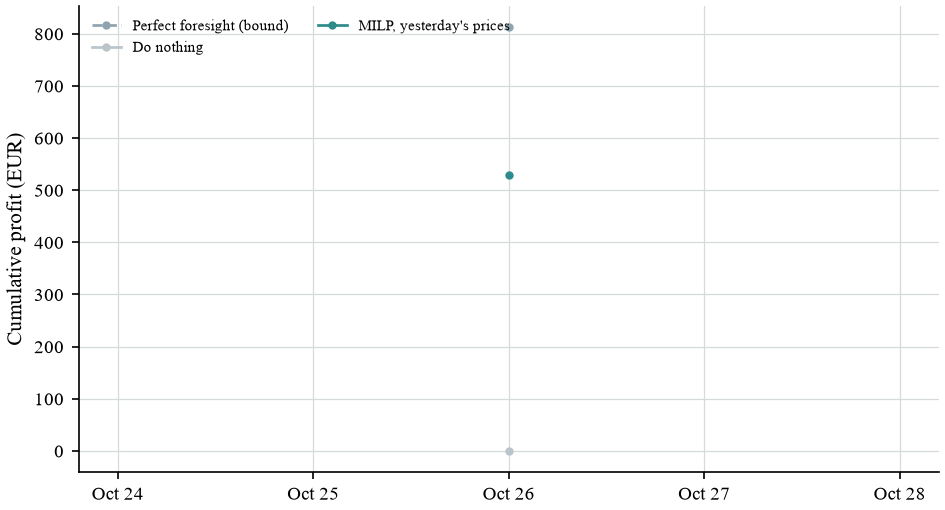

# Live paper test

Day 1 of 15 · last scored delivery day: **October 26, 2026** · ledger intact (13 entries) · updated October 25, 2026, 2:32 PM (Warsaw)

Every morning, each agent fixes its schedule for the next day before the 12:00 day-ahead gate. Once the prices are published, the schedule is scored. Nothing is sent to the market: this is paper trading with a 1 MW / 2 MWh battery, and profits include a wear cost of €10 per MWh moved. The test started from fresh prices on October 26, 2026, so the agents that need a week of history joined later (see the Days column).

## Standings

| Agent | Days | Total (EUR) | Per day (EUR) | % of bound | Losing days |
|---|---:|---:|---:|---:|---:|
| Perfect foresight (bound) | 1 | 812.12 | 812.12 | 100.0 | 0 |
| MILP, yesterday's prices | 1 | 529.42 | 529.42 | 65.2 | 0 |
| Do nothing | 1 | 0.00 | 0.00 | 0.0 | 0 |

"% of bound" compares an agent with perfect foresight on the same days.

## Cumulative profit

## Daily reports

- [Monday, October 26, 2026](reports/GridMind_daily_report_2026-10-26.pdf)

## Files

- `ledger.jsonl`: the hash-chained ledger (schedules, scores, hashes). Check it with `python live_task.py status` in GridMind Lab, or recompute each SHA-256 over the entry without its `hash` field.
- `../../data/polish/live/provenance.json`: SHA-256 of every downloaded price file.
- ENTSO-E prices are not in this repository: their license does not allow redistribution. The public reports leave them out; anyone with an ENTSO-E token can download the same days and check them against the hashes.

How the test and the desktop workbench work: [docs/GRIDMIND_LAB.md](../../docs/GRIDMIND_LAB.md).
