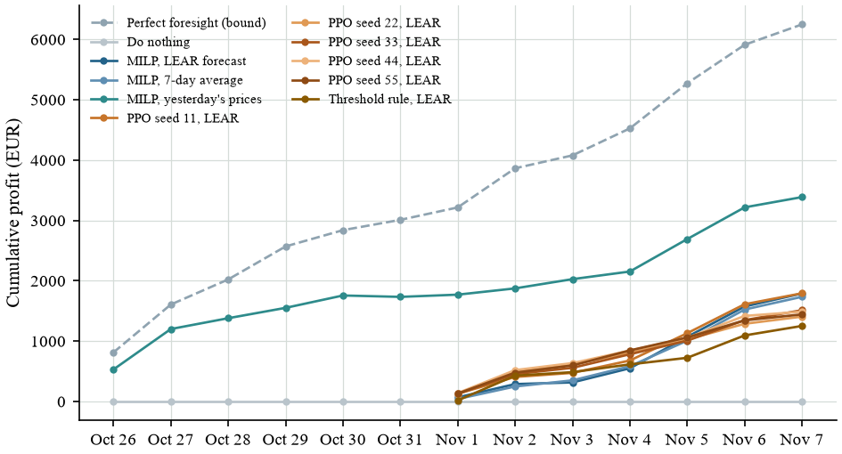

# Live paper test

**Complete:** 15 of 15 delivery days, October 26–November 9, 2026 · ledger intact (267 entries) · last scored on November 8, 2026, 2:31 PM (Warsaw)

Every morning, each agent fixed its schedule for the next day before the 12:00 day-ahead gate. Once the prices were published, the schedule was scored. Nothing is sent to the market: this is paper trading with a 1 MW / 2 MWh battery, and profits include a wear cost of €10 per MWh moved. The test started from fresh prices on October 26, 2026, so the agents that need a week of history joined later (see the Days column).

## Standings

| Agent | Days | Total (EUR) | Per day (EUR) | % of bound | Losing days |
|---|---:|---:|---:|---:|---:|
| Perfect foresight (bound) | 15 | 7,918.83 | 527.92 | 100.0 | 0 |
| MILP, yesterday's prices | 15 | 4,666.30 | 311.09 | 58.9 | 1 |
| MILP, LEAR forecast | 9 | 3,168.81 | 352.09 | 64.5 | 0 |
| MILP, 7-day average | 9 | 3,167.79 | 351.98 | 64.5 | 0 |
| PPO seed 11, LEAR | 9 | 3,167.21 | 351.91 | 64.5 | 0 |
| PPO seed 33, LEAR | 9 | 2,475.11 | 275.01 | 50.4 | 0 |
| PPO seed 44, LEAR | 9 | 2,249.19 | 249.91 | 45.8 | 0 |
| Threshold rule, LEAR | 9 | 2,194.33 | 243.81 | 44.7 | 0 |
| PPO seed 55, LEAR | 9 | 2,103.24 | 233.69 | 42.8 | 0 |
| PPO seed 22, LEAR | 9 | 2,047.97 | 227.55 | 41.7 | 0 |
| Do nothing | 15 | 0.00 | 0.00 | 0.0 | 0 |

"% of bound" compares an agent with perfect foresight on the same days.

## Result

On the nine days on which every agent traded, November 1–9, 2026:

| Agent | Per day (EUR) | % of bound | Lowest day (EUR) |
|---|---:|---:|---:|
| MILP, LEAR forecast | 352.09 | 64.5 | 27.77 |
| MILP, 7-day average | 351.98 | 64.5 | 40.19 |
| MILP, yesterday's prices | 325.97 | 59.8 | 36.84 |
| PPO, LEAR, mean of five seeds | 267.62 | 49.1 | 68.08 to 104.20 |
| Threshold rule, LEAR | 243.81 | 44.7 | 16.39 |

MILP on the LEAR forecast earned 26.12 EUR/day more than MILP on yesterday's prices and more on six of the nine days. The PPO seeds stayed below MILP on the same forecast; the best seed (seed 11) came within 0.18 EUR/day of it. No agent that uses a forecast lost money on any day; over its 15 days, MILP on yesterday's prices lost money once (−23.11 EUR on October 31, 2026). Nine days are too few for intervals, so these numbers are descriptive; the evidence with intervals is the confirmatory test of July–August 2026.

## Cumulative profit

## Timing of the schedules

Every schedule entry records when it was made (`created_utc`) and its gate (`gate_utc`); every one was made before its gate. The push to GitHub adds an outside timestamp. For 12 of the 15 delivery days it came before the gate; for three it came later:

| Delivery day | Schedules in the ledger (UTC) | Pushed to GitHub (Warsaw) | Commit |
|---|---|---|---|
| October 28, 2026 | October 27, 09:00 | October 27, 21:58 | 1bb4c80 |
| October 30, 2026 | October 29, 09:24 | October 30, 10:06 | 964a99e |
| November 9, 2026 | November 7, 18:24 | November 8, 12:26, before the prices of November 9 were published | 5500a58 |

On October 28 and 30 only MILP on yesterday's prices and "do nothing" traded. To check that no schedule used the prices of its own delivery day, all 102 schedules were recomputed on November 9, 2026 from the price history up to the day before delivery: for every entry, the hash of that history, the hash of the forecast and all 96 power values matched the ledger exactly.

## Daily reports

- [Monday, November 9, 2026](reports/GridMind_daily_report_2026-11-09.pdf)
- [Sunday, November 8, 2026](reports/GridMind_daily_report_2026-11-08.pdf)
- [Saturday, November 7, 2026](reports/GridMind_daily_report_2026-11-07.pdf)
- [Friday, November 6, 2026](reports/GridMind_daily_report_2026-11-06.pdf)
- [Thursday, November 5, 2026](reports/GridMind_daily_report_2026-11-05.pdf)
- [Wednesday, November 4, 2026](reports/GridMind_daily_report_2026-11-04.pdf)
- [Tuesday, November 3, 2026](reports/GridMind_daily_report_2026-11-03.pdf)
- [Monday, November 2, 2026](reports/GridMind_daily_report_2026-11-02.pdf)
- [Sunday, November 1, 2026](reports/GridMind_daily_report_2026-11-01.pdf)
- [Saturday, October 31, 2026](reports/GridMind_daily_report_2026-10-31.pdf)
- [Friday, October 30, 2026](reports/GridMind_daily_report_2026-10-30.pdf)
- [Thursday, October 29, 2026](reports/GridMind_daily_report_2026-10-29.pdf)
- [Wednesday, October 28, 2026](reports/GridMind_daily_report_2026-10-28.pdf)
- [Tuesday, October 27, 2026](reports/GridMind_daily_report_2026-10-27.pdf)
- [Monday, October 26, 2026](reports/GridMind_daily_report_2026-10-26.pdf)

## Files

- `ledger.jsonl`: the hash-chained ledger (schedules, scores, hashes). Check it with `python live_task.py status` in GridMind Lab, or recompute each SHA-256 over the entry without its `hash` field.
- `../../data/polish/live/provenance.json`: SHA-256 of every downloaded price file.
- ENTSO-E prices are not in this repository: their license does not allow redistribution. The public reports leave them out; anyone with an ENTSO-E token can download the same days and check them against the hashes.

How the test and the desktop workbench work: [docs/GRIDMIND_LAB.md](../../docs/GRIDMIND_LAB.md).
